# A7 – FEA on a Bracket

## Objective

- Use Finite Element Analysis (FEA) to improve the bracket design from previous assignments.
- Ensure high stiffness, strength, and lightweight optimization through iterative design.
- Conduct multiple FEA simulations, refining geometry based on results.
- Perform static stress analysis, including constraints, loading, and meshing selection.
- Interpret data by identifying max stress, displacement, and safety factors.
- Optimize the design by modifying geometry to enhance performance.
- Document the entire process with images, calculations, and insights.
- Reflect on key engineering lessons learned and time spent.

## Description

Your task is simply to create a high stiff, high strength, and lightweight component. Use Finite Element analysis to drive your decision making process throughout your design. Each step of the analysis and before you make geometric changes make sure the component’s results (stress/displacement/Safety Factor) converge on a 7% difference. Achieve this by modifying the number of elements. If after three attempts to converge use the stiffness and stress from the finer mesh size use the finest mesh size and proceed through the process.

## Analyze

### Simulation Setup

Before I did anything with simulations, I made sure to assign my bracket a material. Since I chose ASTM A36 steel, I looked that up in the material list provided in SolidWorks. Luckily, the material was already included in SolidWorks materials, so I didn't have to make a new entry for it. I selected the material and then moved onto configuring the simulations

    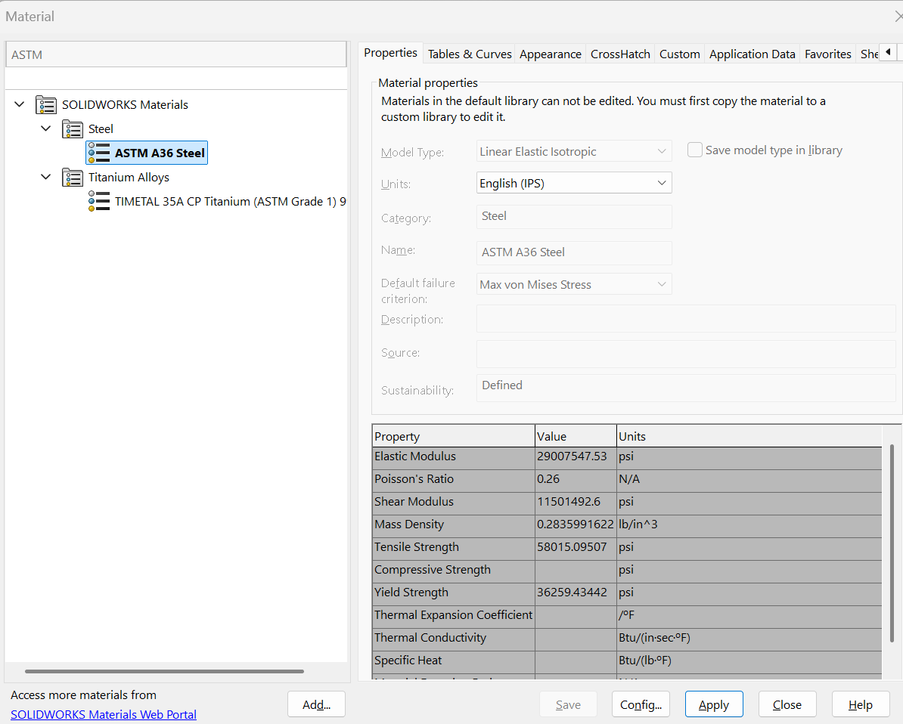

I want to make sure my simulations are all consistent from each other. For all of my simulations, I have made the inside of the bracket all fixed since that should be the part sliding onto something. There shouldn't be any movement in that area. I then applied my 650lbf force onto the rod portion at the bottom. This part of the bracket should be experiencing most of the force upon my part.

<table style="width:100%;">
  <tr>
    <td style="width:50%; text-align: center; vertical-align:middle;">
      
    </td>
     <td style="width:50%; text-align: center; vertical-align:middle;">
       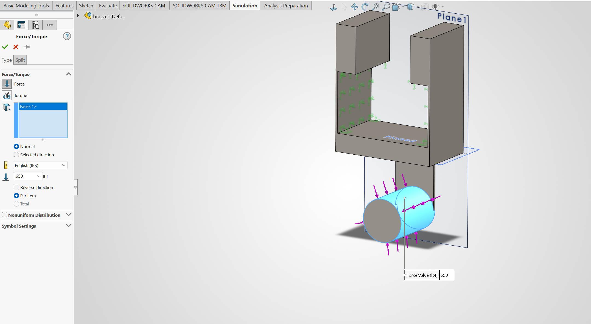
    </td>
  </tr>
</table>

Once I had my material, fixed points, and forces, the only thing I needed to do was add a mesh to my design. I decided to my mesh as compact as possible to get more accurate readings. I am aware that SolidWorks can encounter bugs, however we were told to ignore that for this assignment.

### Design 1

Design 1 is just my original design but tested through the simulation to see if it can actually stand up to the load applied onto it. This will go past just calculations on paper. It will give a visual representation of what is happening

    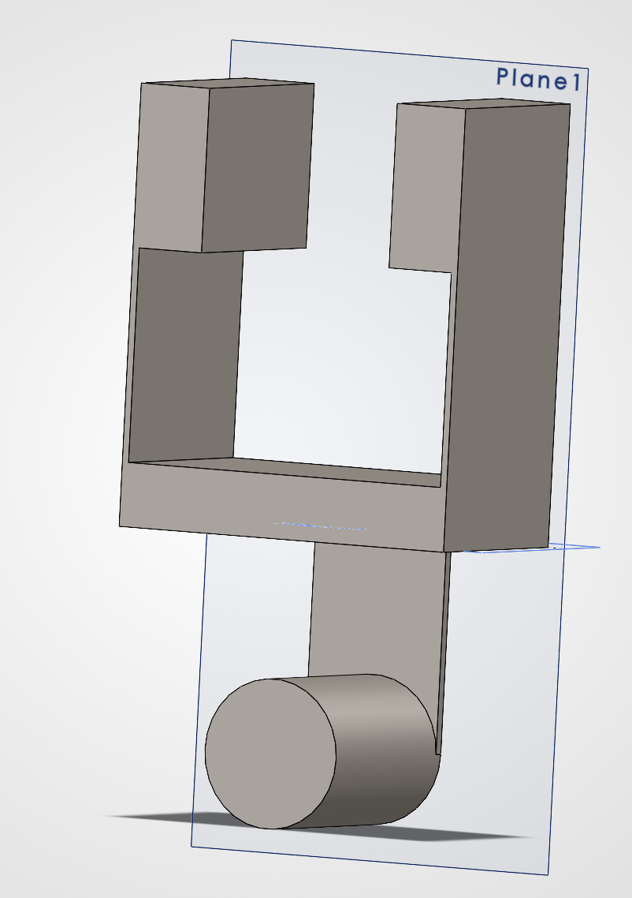

#### Stress

Here is the stress diagram for design 1. A lot of the stress applied to the design was along the rod portion of the part. That is probably because my thickness for feature B is super thin compared to the rest of the part. I didn't show it in the screenshot, but there is a red stress indicator on the back of the part where feature B and feature C intersect at the corners. I didn't notice it while doing the analysis, so I didn't try to fix it in design 2, but it is worth mentioning. This means that the highest stress applied to the part is 1.54 * 10^6 N/m^2. That is incredibly high, but it is still under my yield strength

    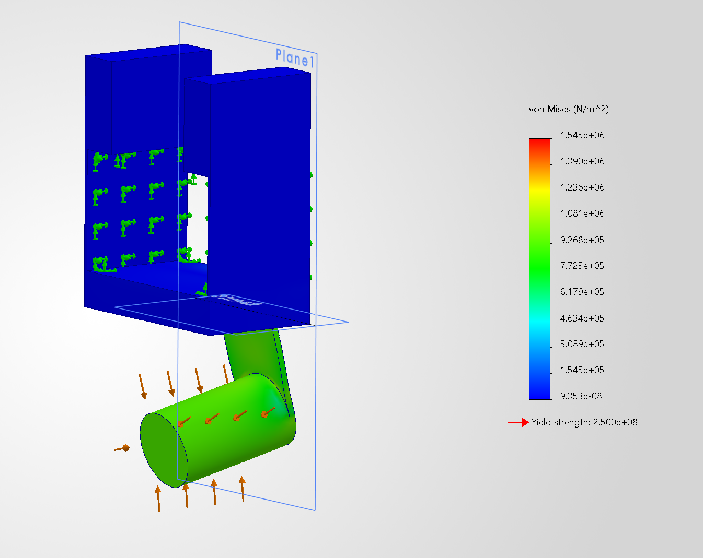

#### Deflection

Here is the deflection diagram. Similar to the stress diagram, a lot of the deflection occurred around feature A and feature B. I decided to show the back this time since that is where the majority of the deflection was occurring. It looks like the very back of feature A has the highest deflection at 4.725*10^-4 mm. This is well within our goals of 0.25mm, so it should be fine for our use.

    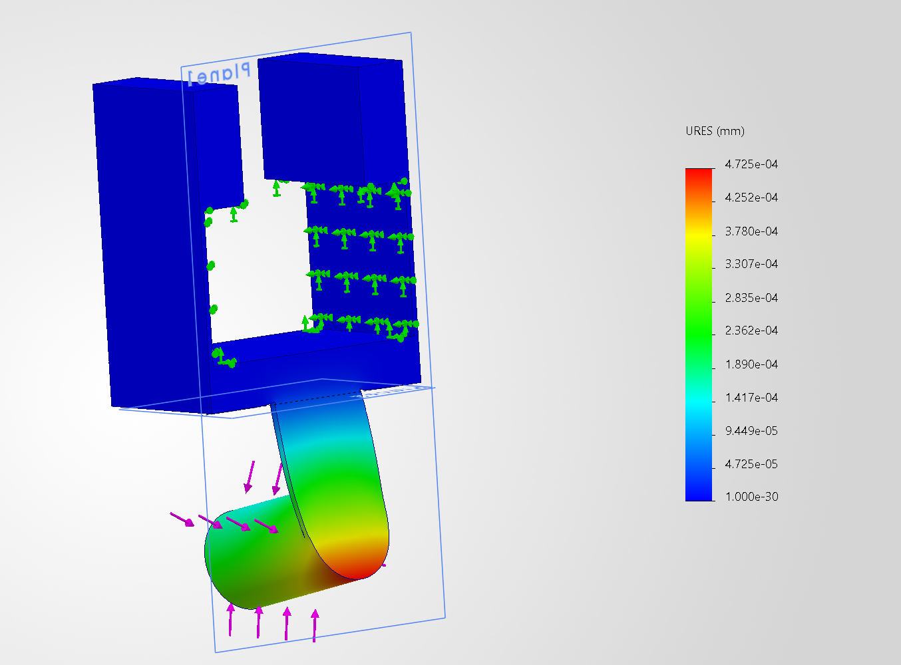

#### Safety Factor

Here is the factor of safety diagram. When I originally did this graph, my entire part was red, so I got concerned; however, I noticed that it was reading all the way in the hundreds. To fix this, I made the max factor safety to be 15. Seeing how the entire part has a safety factor of 15, I am well within the design requirements for this design.

    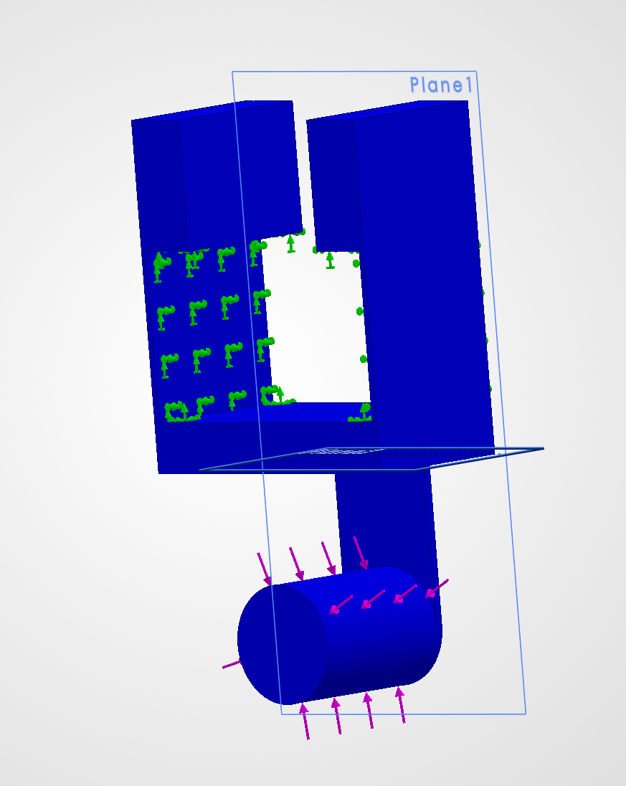

#### Possible Improvements

Seeing how the biggest stress and movement in the part is in feature B, I should apply more support to feature B while shaving off material near the top of my bracket. This should save on weight, while help make the part stronger. For this next design, I decided to focus on just supporting feature B since that was main concern from the simulation.

### Design 2

Design 2 has only one change in it. I added these two angled beams from the bottom of feature B to the bottom of feature C. I was hoping that the extra material near feature B would cause less stress and deflection.

    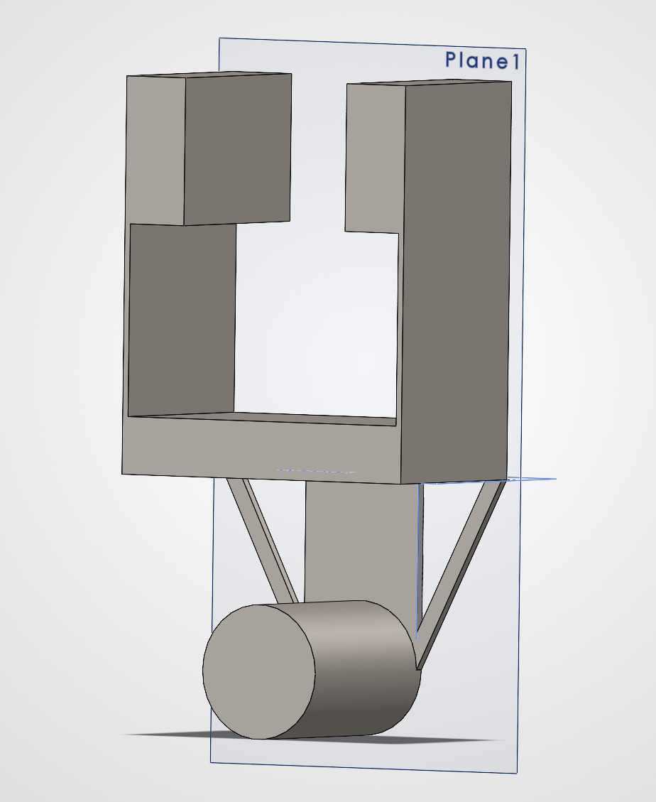

#### Stress

Here is my stress diagram for design 2. I have very similar issues as design 1. I noticed the severe stress points this time and plan on addressing it in design 3. Even though there are still high stress areas, it appears that the maximum stress applied to feature B is smaller than in design 1. The max stress for design 2 is 1.318*10^6 N/m^2. that is a pretty decent difference for such a small change.

    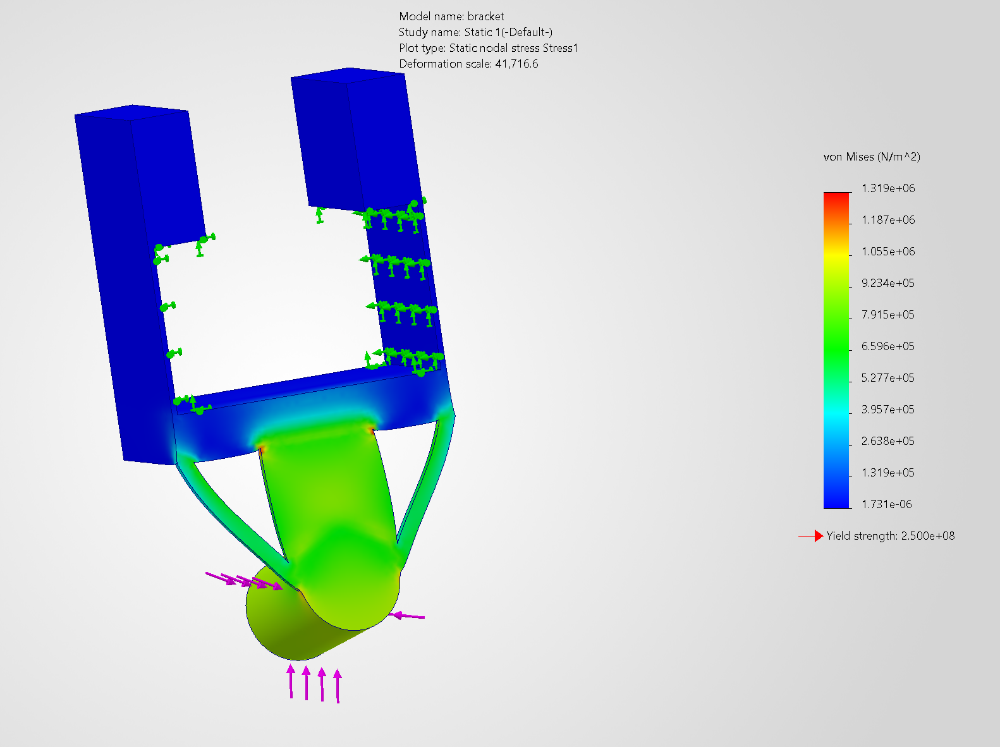

#### Deflection

Here is my deflection diagram for design 2. I had very similar results for deflection as I did for stress between design 1 and design 2. The big deflection areas are still in the same spots, but they are lower in value than previously. The maximum deflection for design 2 is 3.821*10^-4mm. This is lower than design 1 and well within the design goals.

    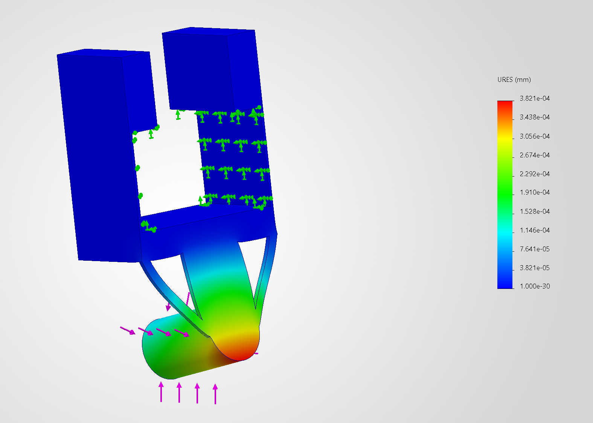

#### Safety Factor

Here is my factor of safety diagram for design 2. Due to both my stress and deflection values being smaller than design 1, I should maintain the same capped factor of safety. Based on the graph, this looks to be true.

    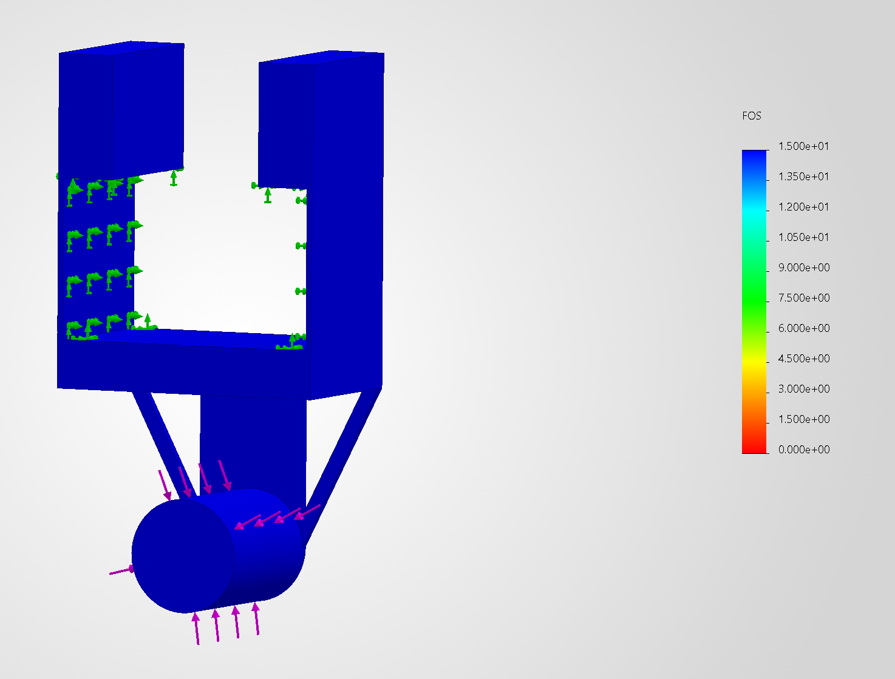

#### Possible Improvements

I think to minimize stress concentrations, I should fillet the part so that there are no sharp edges for stress to build up at. To help optimize for weight, I should be removing material the low stress regions (feature C and above). 

### Design 3

I made a few changes in design 3. I increased the thickness of feature B and the supports. I wanted to make the supports a 45 degree angle from feature B to connect to the bottom of feature C, but I had a lot of issues figuring out how to do that in SolidWorks, so I just decided to pass on that idea. I also made sure to fillet the high stress areas (feature B). I was hoping this would make my part even stronger. I made a large cutout in the middle of feature D and feature E to hopefully remove a lot of material. To help keep the structural integrity, I created these x's in the middle. That should keep the structure while removing weight and being functional.

    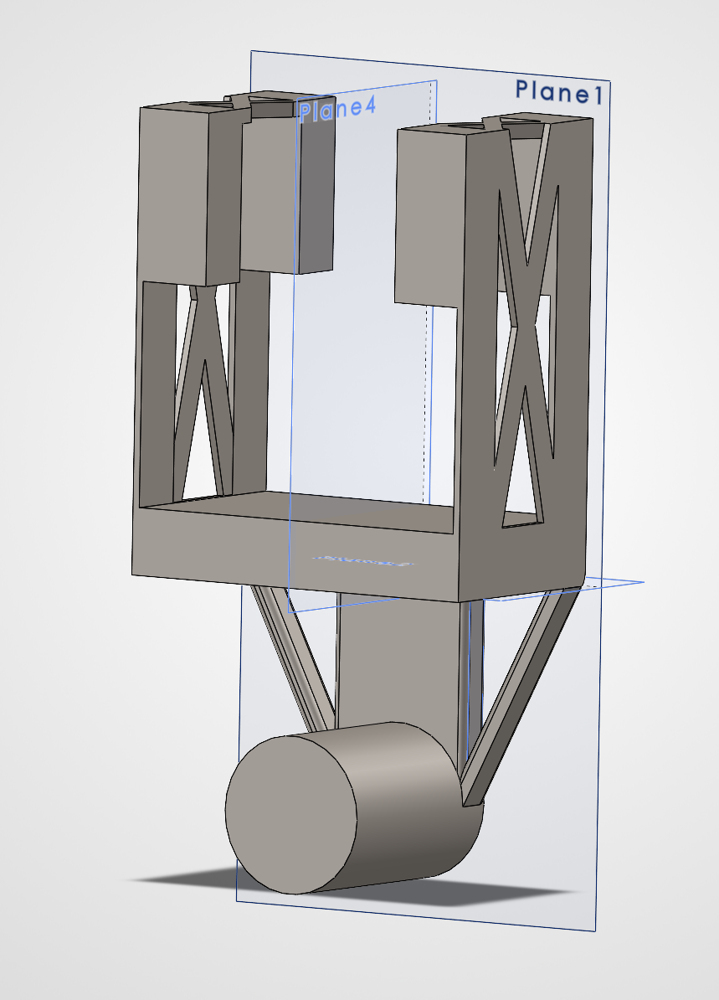

#### Stress

Here is my stress diagram for design 3. Based on the results, it doesn't seem that it helped the stress capabilities as much as I thought it would. I didn't have any full red areas on my design, but the highest stress concentration is still in that connection of feature B to feature C. This means my max stress is between 1.454*10^6 N/m^2 and 1.615*10^6 N/m^2. Both of these values are higher than design 2, which I found pretty interesting. I am not sure why that it is the case, but it shouldn't matter in the end.

    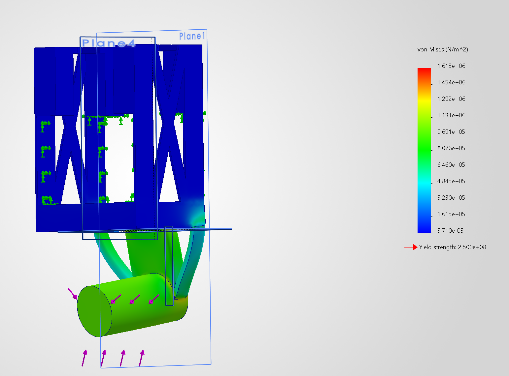

#### Deflection

Here is my deflection diagram for design 3. The same area on my part has the max deflection point, but it is lower than in design 2. The max deflection is only 3.435*10^-4mm. A slight improvement. Based on the stress diagram, I suppose that means I am trading higher stress for less deflection in my part.

    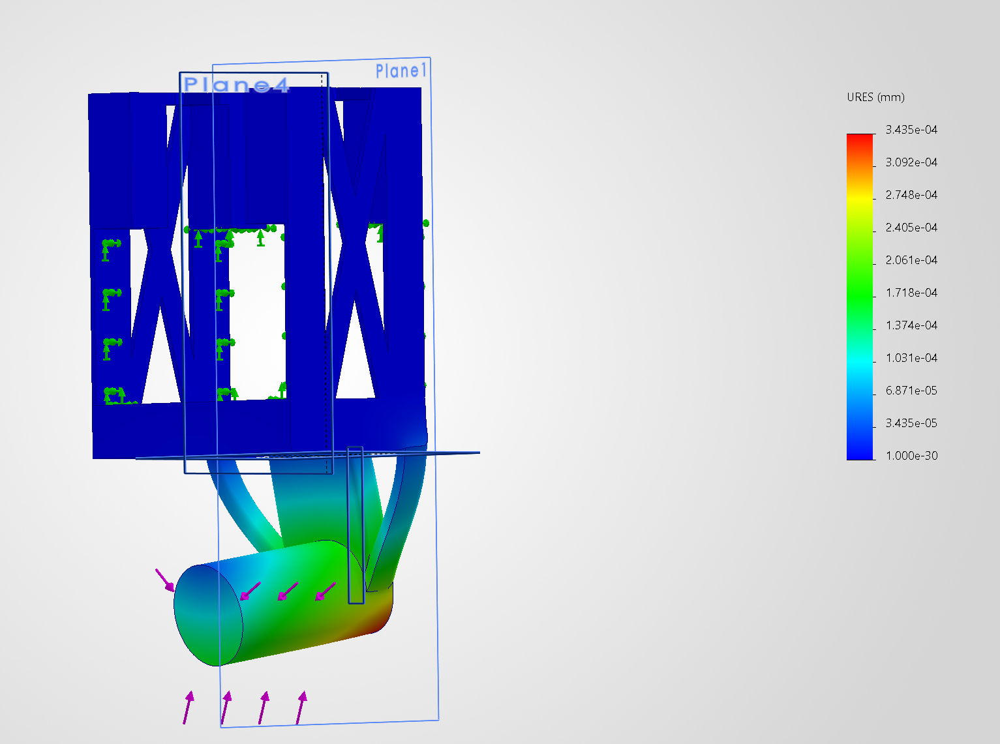

#### Safety Factor

Here is my factor of safety diagram. Based on my past 2 designs, I expect a safety factor of 15. Fortunately that is what ends up being the result. This means my final design is well within the design goals for this project.

    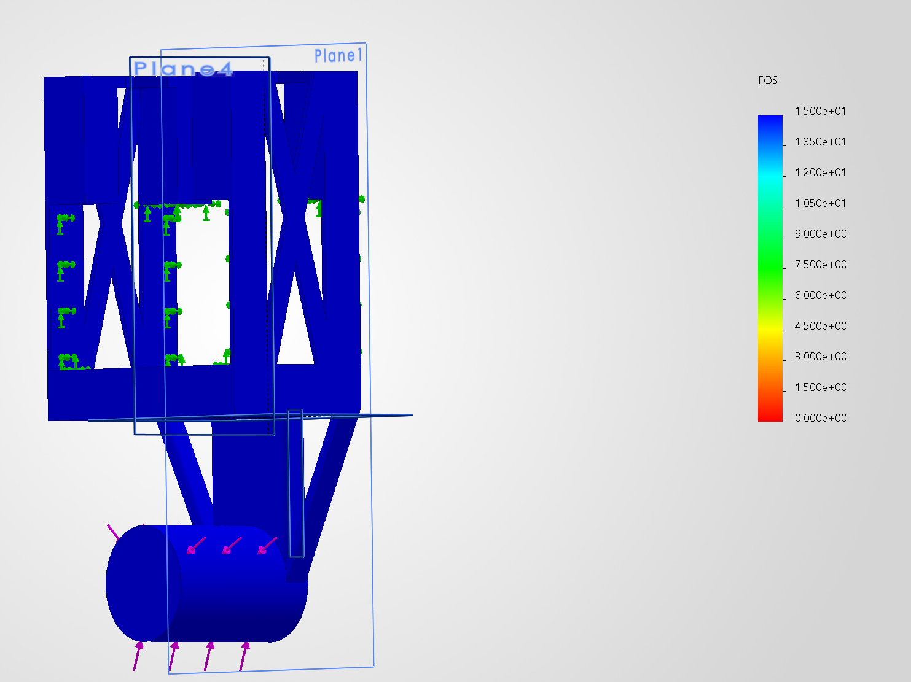

#### Possible Improvements

Even though I am not doing another design, I think it is still good to mention possible improvements. I think there is a way I could minimize more material usage to make my part lighter. Maybe if I shell out feature A so that is more of a hollow cylinder than a fully filled cylinder. This should affect my stress statistics that much, and it would save on material. If I ever figure out how to do my 45 degree idea, I think that would be beneficial as well.

### CAD File

Here is the CAD file for my final design: [CAD File](bracket.SLDPRT)

### Data sorted

<table style="width:100%; border-collapse:collapse; text-align:left;">
  <thead>
    <tr>
      <th style="border:1px solid black; padding:8px;"></th>
      <th style="border:1px solid black; padding:8px;">Design I</th>
      <th style="border:1px solid black; padding:8px;">Design II</th>
      <th style="border:1px solid black; padding:8px;">Design III</th>
    </tr>
  </thead>
  <tbody>
    <tr>
      <th style="border:1px solid black; padding:8px;">Max Stress (*10^6 N/m^2) and Location</th>
      <td style="border:1px solid black; padding:8px;">1.545 where feature B and feature C connect</td>
      <td style="border:1px solid black; padding:8px;">1.319 where feature B and feature C connect</td>
      <td style="border:1px solid black; padding:8px;">1.454 where feature B and feature C connect</td>
    </tr>
    <tr>
      <th style="border:1px solid black; padding:8px;">Max Deflection (*10^-4 mm) and Location</th>
      <td style="border:1px solid black; padding:8px;">4.725 back of feature A</td>
      <td style="border:1px solid black; padding:8px;">3.821 back of feature A</td>
      <td style="border:1px solid black; padding:8px;">3.45 back of feature A</td>
    </tr>
    <tr>
      <th style="border:1px solid black; padding:8px;">Mass (lbs)</th>
      <td style="border:1px solid black; padding:8px;">1.488</td>
      <td style="border:1px solid black; padding:8px;">1.496</td>
      <td style="border:1px solid black; padding:8px;">1.329</td>
    </tr>
    <tr>
      <th style="border:1px solid black; padding:8px;">Safety Factor</th>
      <td style="border:1px solid black; padding:8px;">15</td>
      <td style="border:1px solid black; padding:8px;">15</td>
      <td style="border:1px solid black; padding:8px;">15</td>
    </tr>
  </tbody>
</table>

Based on these results, my design did get better. I wish I focused more on the weight rather than the stress and deflection since I was already within the goals for this project. I think I saw red on my simulation and got concerned that it was bad. I probably should've capped my stress and deflection so that I had a more accurate reading of the colors on my simulation. That probably would've made me worry about it less. I did end up saving over .1lb of material which isn't great, but better than before.

I would need to optimize this design a little more since my stress difference between design 2 and design 3 is 9.7% and my deflection difference is 10.2%. It is not that far off from our desired 7%, so I would need to do some small optimization in order to reach that.

## 2157 Students Only

We have to repeat the same steps but for the link this time

### Design 1

My design 1 is my finished design from assignment 6. I constrained the side of my link to be fixed while the forces acted on the inside of where the rod is supposed to go from the bracket. I thought that would give me an accurate simulation.

    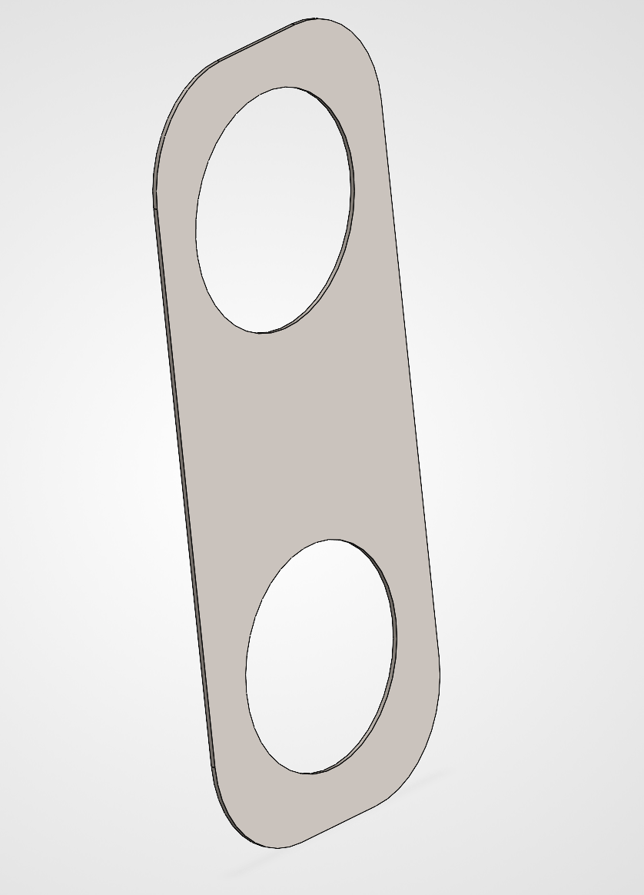

#### Stress

There was a unique shape for the stress, but it was still under the yield stress, so it should still work. With my constraints, it looks like it only really affects the upper radius. 

    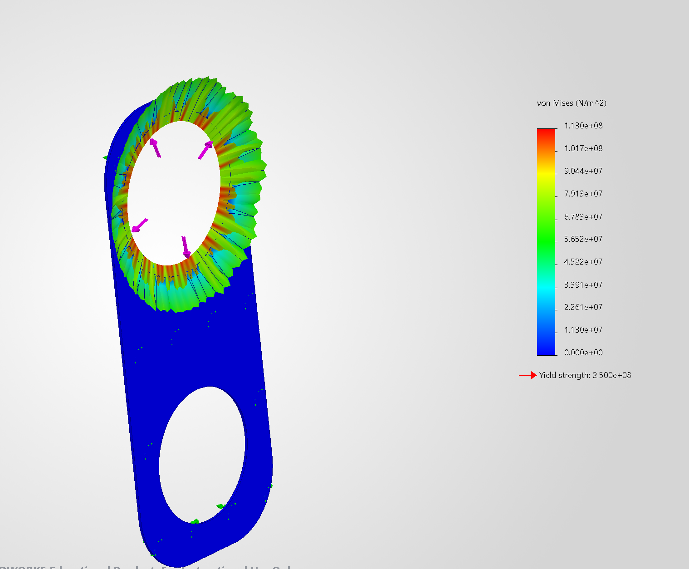

#### Deflection

The deflection map looks very similar. For how exaggerated the deflection is, it only moves 2.605*10^-4mm. This would still be within the design requirements for this project. I plan to improve this though.

    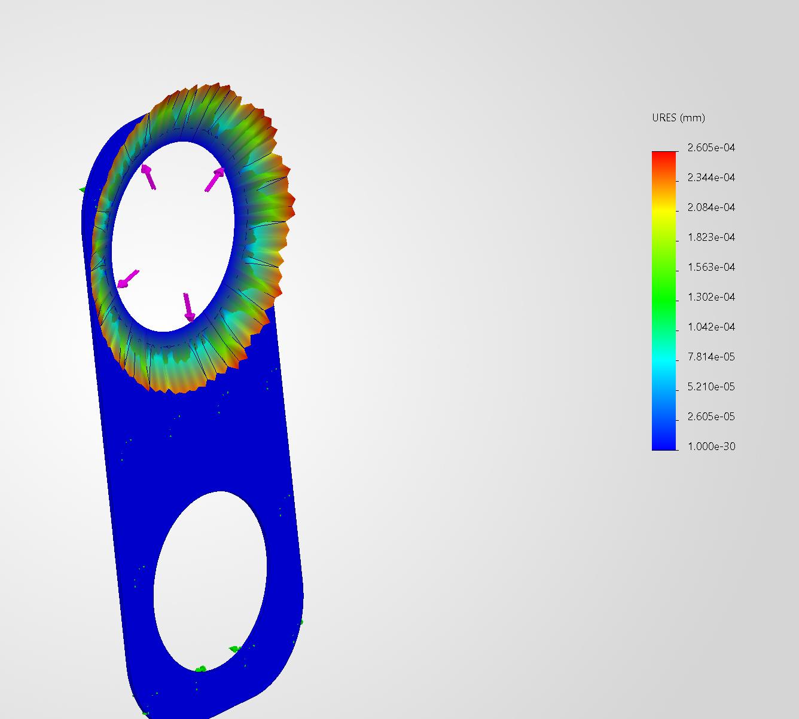

#### Safety Factor

My safety factor was really bad for this design. The lowest safety factor on my part was 2.2, which fails the criteria and will need improvements in the next design.

    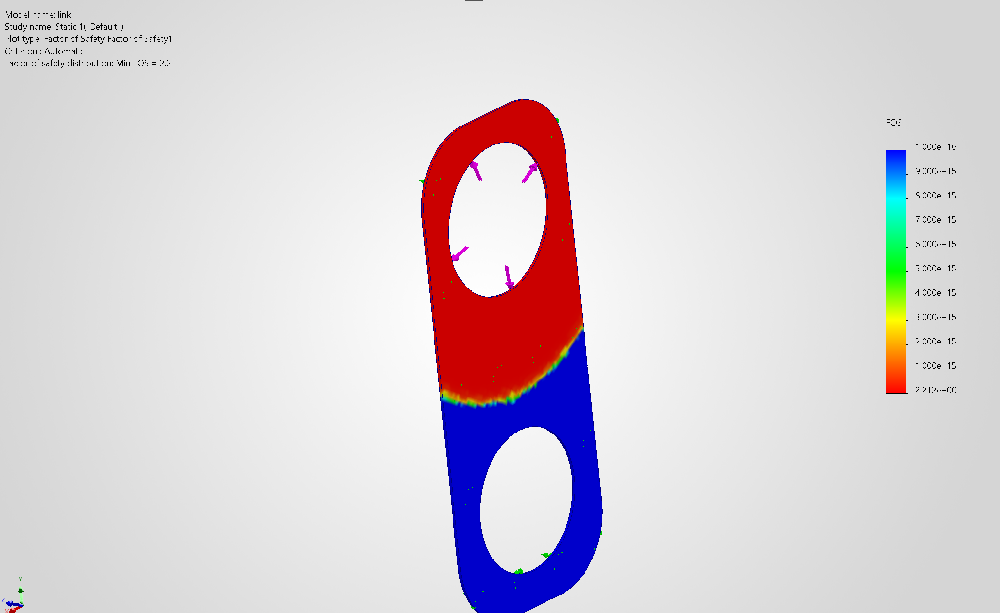

#### Possible Improvements

I think I should probably reinforce the material around the where the rod will be placed. If that has more material, there will be less physical stress on the other components.

### Design 2

For design 2, all I did was add a circle around the main stress points that is a little thicker than the rest of the link. This should minimize the stress and deflection while increasing the safety factor

    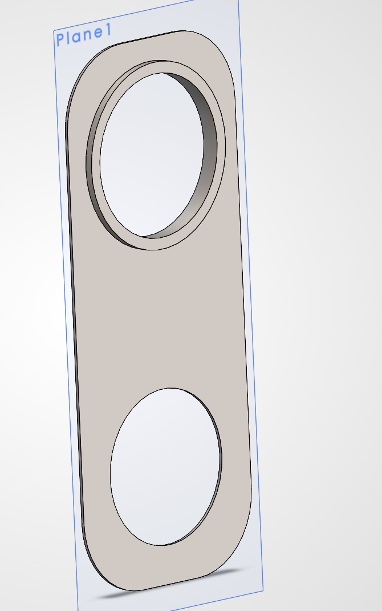

#### Stress

The stress diagram looks even weirder than design 1, but the maximum stress applied is lower. I think that extra material helped the stress build up. I didn't see any red stress points, but it may be hidden under the extra material that was added.

    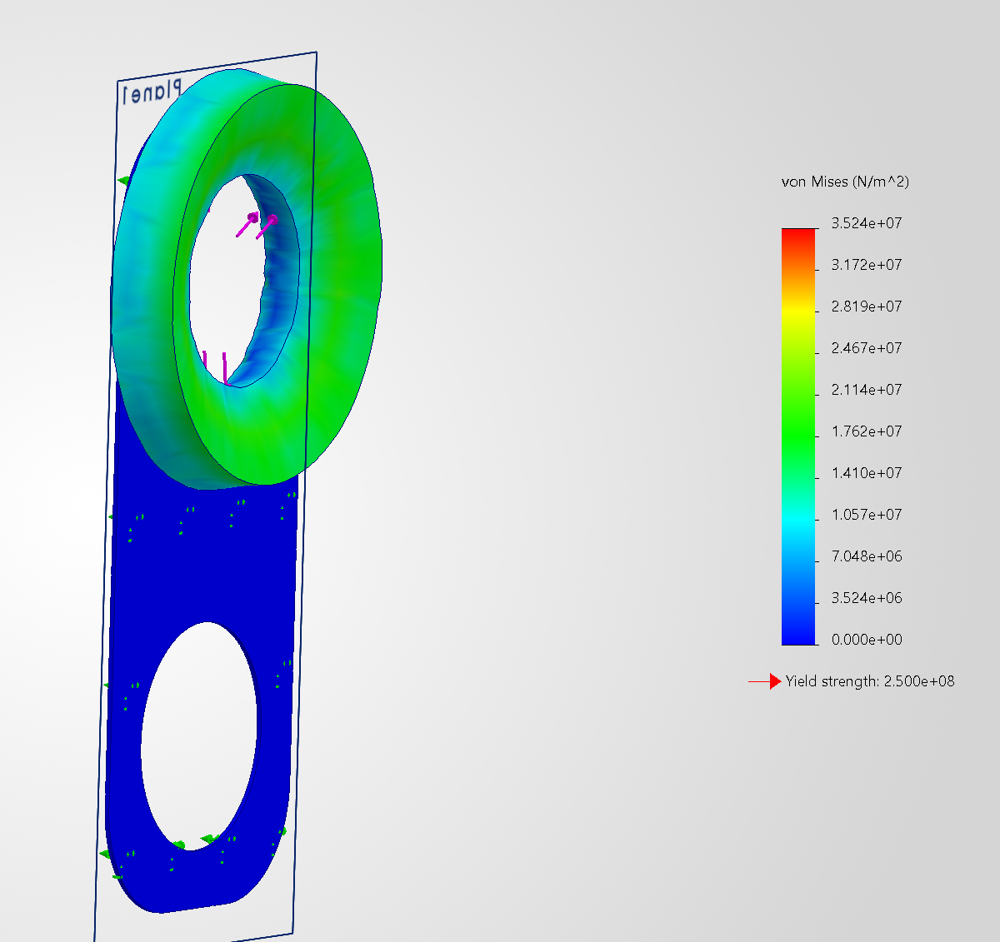

#### Deflection

The deflection graph follows the same trend as the previous graphs. It did increase slightly in maximum deflection, which I found interesting, but it is still under the design requirements for this project.

    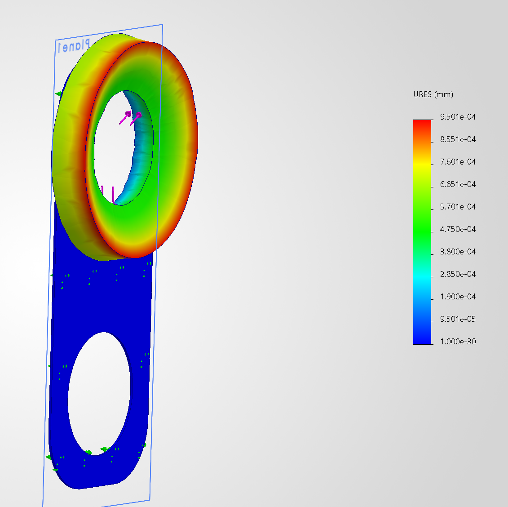

#### Safety Factor

The safety factor graph saw the biggest jump in improvements. The lowest safety factor measured 7.1, which is pretty good and within the design requirements for this project.

    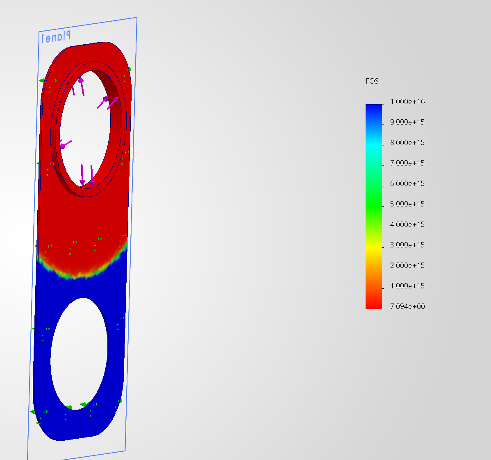

#### Possible Improvements

I think that now I have the physical properties down, I should try and save material, similar to the bracket. I think if I cut out material, it would have to be away from where the main force is applied. The most obvious spot would be to try the center, with an extra support beam, which is what I will try next.

### Design 3

I made a cutout in the middle of my link with a single line down the middle for extra support. I think that is still a high stress area, so I need to keep some type of support there. It can't just be empty. Everything else stayed the same.

    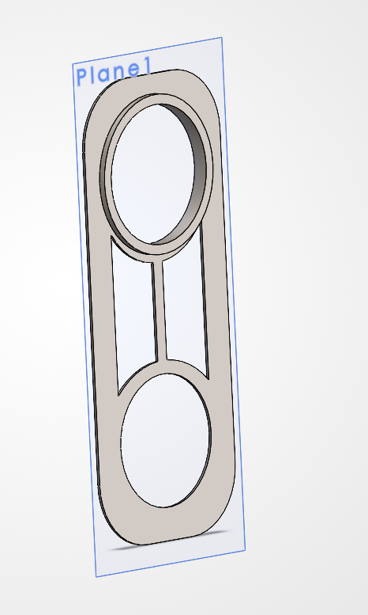

#### Stress

My stress got slightly worse, but it wasn't by a great factor, so I think it will be fine as is with the new changes.

    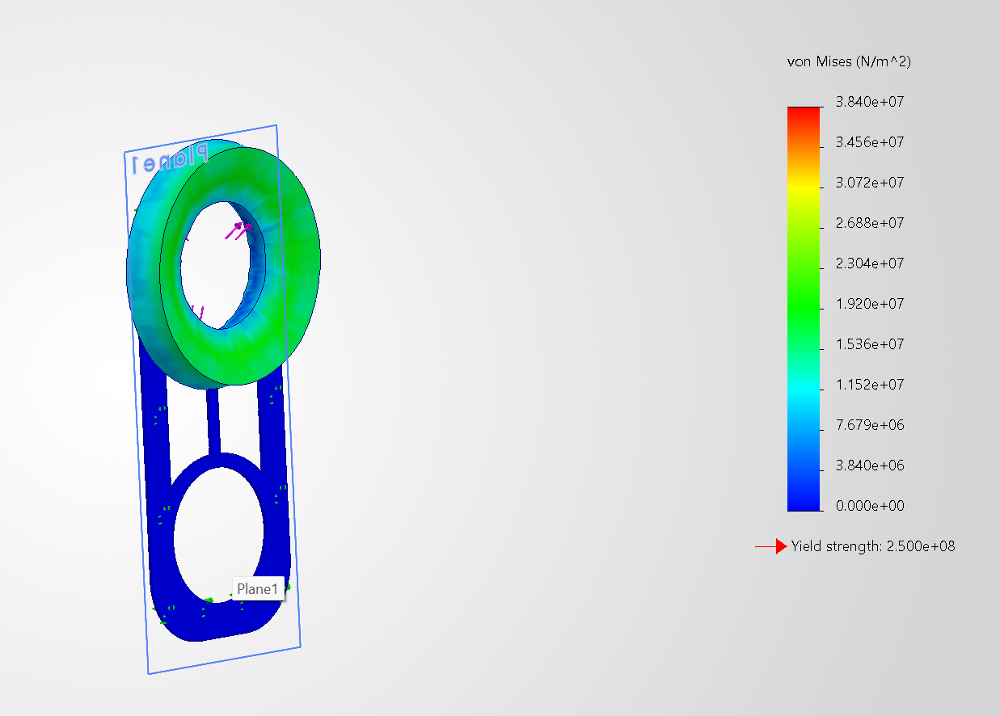

#### Deflection

My deflection also got slightly worse, but it is still by a small margin. It should still work very well as is. I am designing for weight, so that is my primary focus.

    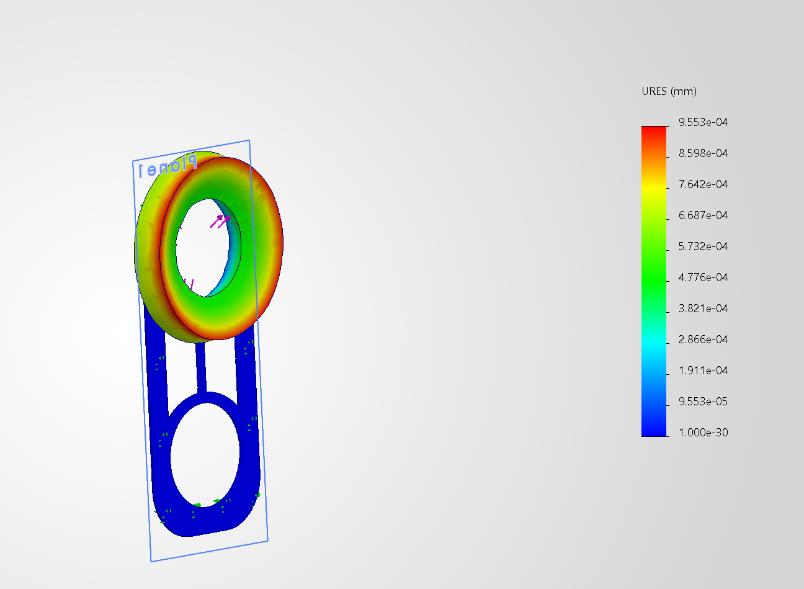

#### Safety Factor

My safety factor also got slightly worse. It seems that all of my physical properties got slightly worse due to the loss in material, which makes sense. I think it is a sacrifice I am making in order to optimize the weight of my design.

    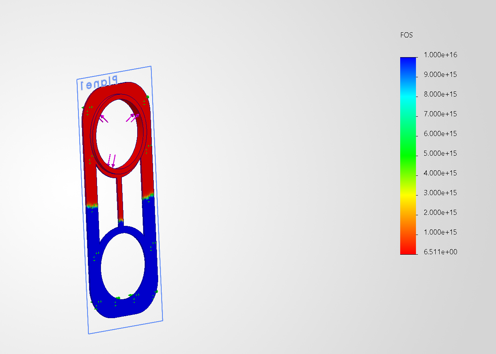

#### Possible Improvements

I think if I were to do another iteration, I would add fillets to the high stress areas. Mainly where I added that support. If I add a fillet there, it will probably decrease the stress slightly. Other than that, I am not sure what else to change.

## Reflection

I learned that you could optimize your part for as long as you want to. I know if you want it super optimize, you may go through over 30+ designs to make it super precise. For the stuff we are doing, that's not necessary, but it is nice to know before I start designing larger projects for other classes/companies. I learned new design techniques in SolidWorks. The main tools I was fiddling with were the fillet tools and the plane tools. I couldn't quite get them to work the way I wanted them to, but I still learned a lot about those tools while designing my bracket. This probably isn't the case for every part, but there are areas on parts that have way lower stress concentration that other areas on that part. It is important to focus on those big stress concentrations to maximize the longevity of that part.
