# A8 – Gears

## Objective

- Design a gearbox that can be assembled and disassembled
- Analyze and size input and output shafts for strength
- Design journal bearings to support shafts
- Create a gearbox housing with proper clearance and fastening
- Use parametric CAD modeling to generate a final design
- Document Calculations, sketches, and lessons learned

### Description

Design a gearbox which can be assembled and disassembled. The spur gears have a gear ratio of 24:9 and are listed in the resource section. The output gear torque and speed are to be 1.25 in-lbf and 1100 rpm relative. The input (pinion,power-transmission) and output (gear, short shaft) shaft diameters are .125 and .25 inches respectively and each have a length of 1 inch. Use the appropriate equations in the Machinery’s Handbook for empirical units. The critical features of the gearbox include the shafts, and the journal bearings.

#### Assumptions

- Assume appropriate strength of shafts, use Machinery's Handbook
- The gear train is ideal
- To moment of the radial force from the gear train is small enough to be ignored
- The shafts are press fit through the hubs of the gears
- Make sure there is enough clearance between the gears and the gearbox
- Use a running sliding fit for the size of the hole for the shafts

## Analyze

### Design of the Shafts

The shafts that were given to use had a diameter of 0.25in and 0.125in, they had the same length of 1in, and we were given a gear ratio the shafts would be attached to. The goal was to find the forces applied to the shafts and if the diameters given were sufficient enough for the current design. Here are the values written down on paper with a visual representation of what is happening.

    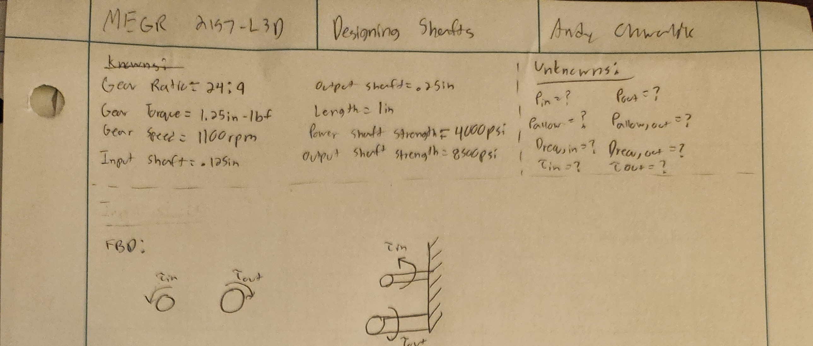

To calculate the diameters, I calculated the stresses and power that is applied to the shaft. The equations I used for power and diameter are both in the lecture slides and the Machinery Handbook. The equation I used for the stress was just a gear ratio equation.

#### Pinion Shaft

I calculated the shaft for the pinion gear first.

    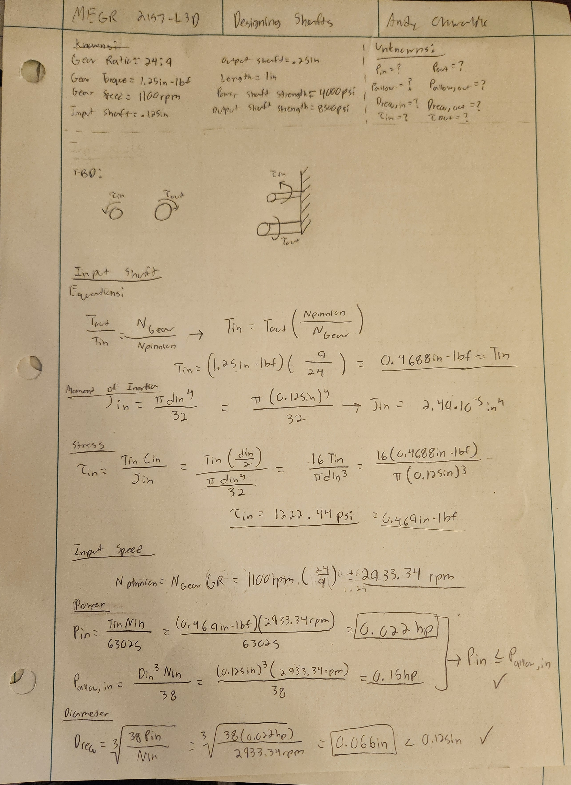

#### Spur Shaft

I then used the exact same steps to calculate the shaft for the spur gear. I already knew the speed and torque for the spur gear, so it was a little easier to calculate.

    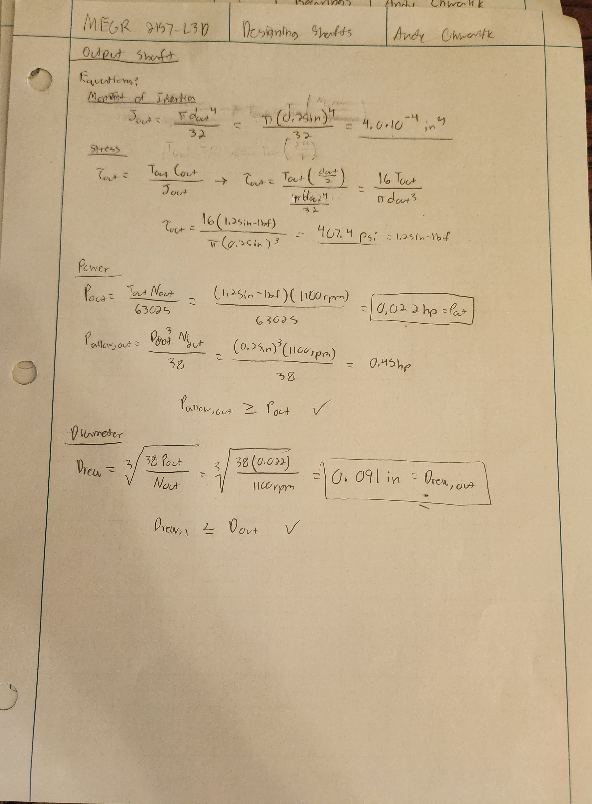

Based on my calculated results, it seems that the given diameters will work just fine. 

### Journal Bearings Design

#### Size, Length, Pressure, Velocity, and PV Rating

To hold the shaft in place, I had to find the properties of a bearing that I will use for my design. There will be a force on the bearing from the shaft and from the housing it will be in. I first calculated the tangential force and then the axial load on the bearing. I used these values to find the pressure, velocity, and PV Rating to get a material for my bearing. My material was picked from a table inside the lecture slides that best fit my results.

    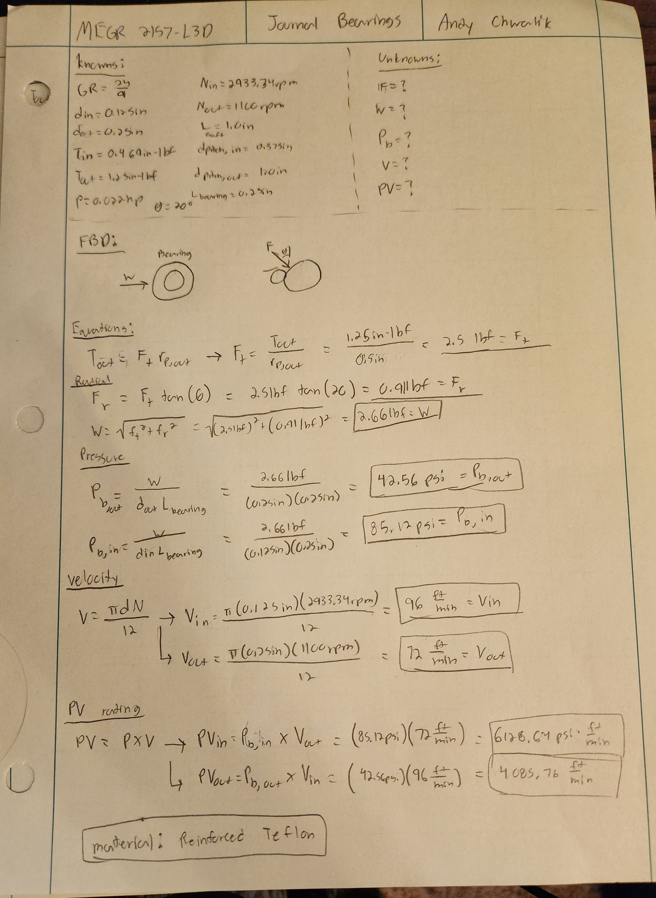

I then calculated what was supposed to be the thickness for the bearing. I had two equations for this, and I was just able to plug in my known values for this step in the process. I get very close to 1/16 of an inch of material. 

    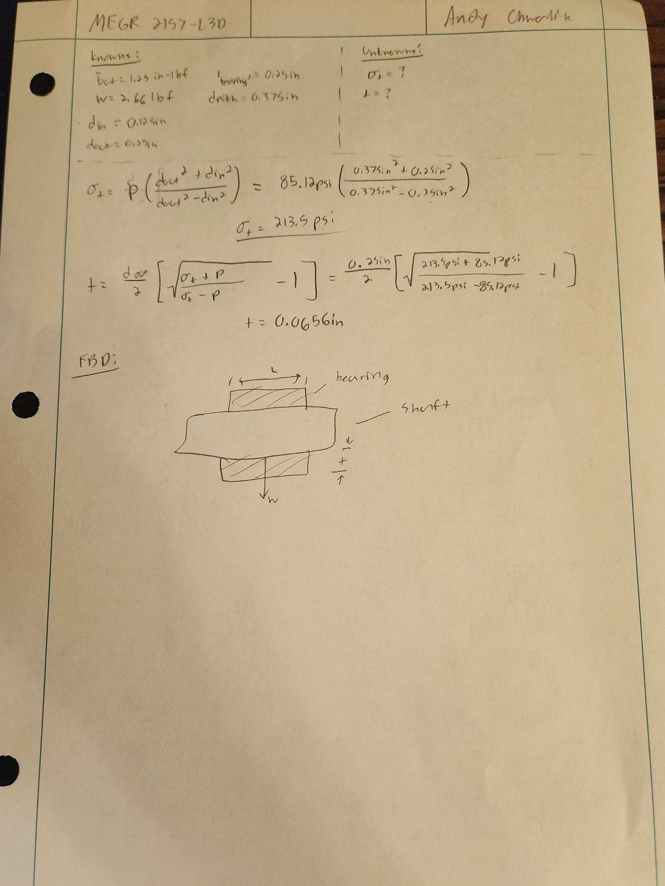

### McMaster Carr Parts

When searching for the bearing, I was looking for the bearing length (0.25in) and the shaft diameter (0.25in or 0.125in). That would at least fit my part. Every bearing that I am looking at appears to fit the requirements from my shaft/gears. The only thing I couldn't really find was the material I wanted to use. I picked reinforced teflon from the material table in the lecture slides, but I am struggling to find that material on the McMaster website. To fix this, I am just going to look for a material that will resist my requirements. I am not going to worry about how close it is or not.

Based on looking through the website, it appears that the best material substitute would be high-strength 932 bearing bronze.

The best sleeve bearing I could find for the spur bearing is: [6381K409](https://www.mcmaster.com/6381K409/). 
The best sleeve bearing I could find for the pinnion bearing is: [6381K406](https://www.mcmaster.com/6381K406/).

These sleeve bearings are matching in material and should hold the required stresses and loads applied to them.

To connect my housing together, I needed a screw, and I found this screw on the website. I decided to just use it: [91251A0550](https://www.mcmaster.com/91251A055/).

I also found the two gears that we were using for this assignment. 

Here is the pinion gear: [7880K19](https://www.mcmaster.com/7880K19/).  
Here is the spur gear: [7880K24](https://www.mcmaster.com/7880K24/)

## Design

Before I made a CAD model, I made a really rough sketch of what I was planning my CAD file to look like. I wanted to make a mold that fit the gears perfectly where a screw would connect the two housing spaces.

    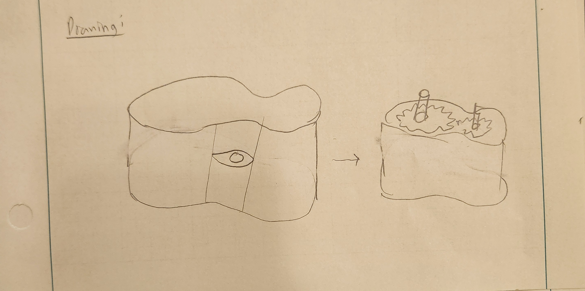

After I had my rough sketch, I moved onto the CAD design.

### Spur Shaft

For the spur shaft, I parametrically designed it using the equations from earlier. I thought that it would help for any changes that I made, but I think it took me longer to set up the table than I spent on the entire document.

    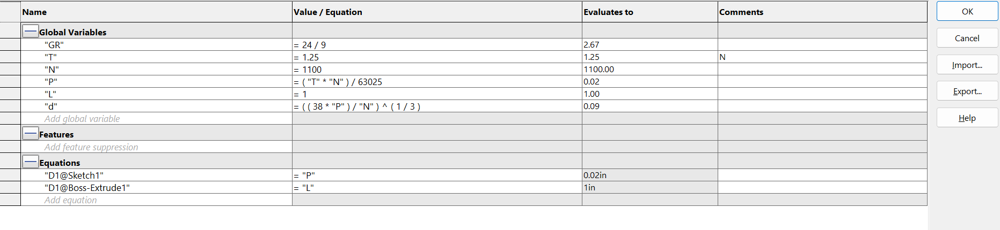

Here is what the design looks like

    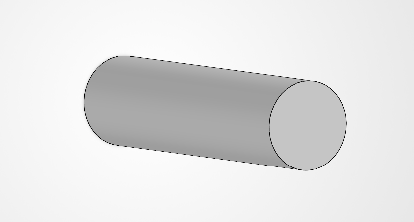

### Pinion Shaft

I also made a table for the pinion shaft.

    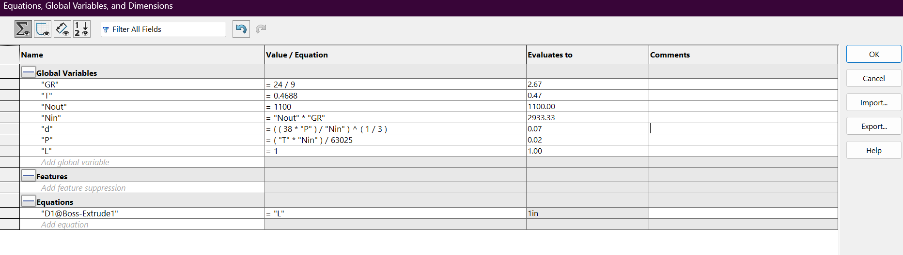

Here is what the final shaft looks like

    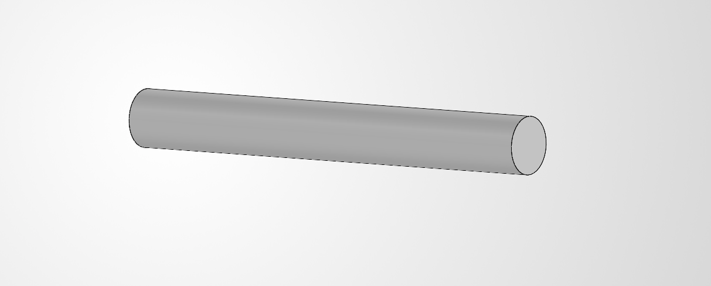

### Housing

I next worked on the bottom of the housing. I had the gears and bearings from McMaster Carr Parts, so I thought it was the next logical step. I didn't create a table for this one because I wasn't sure how to use it.

#### Bottom

Here is what the bottom housing looks like

    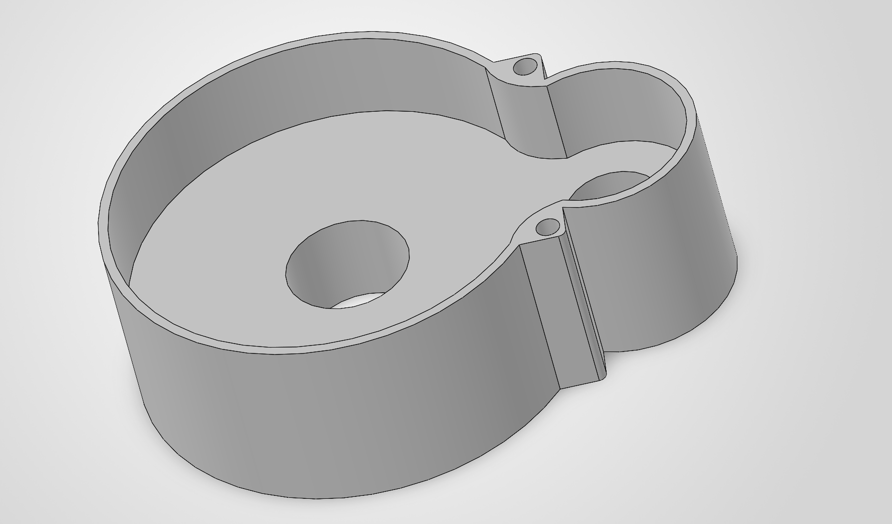

#### Top

Here is what the top housing looks like

    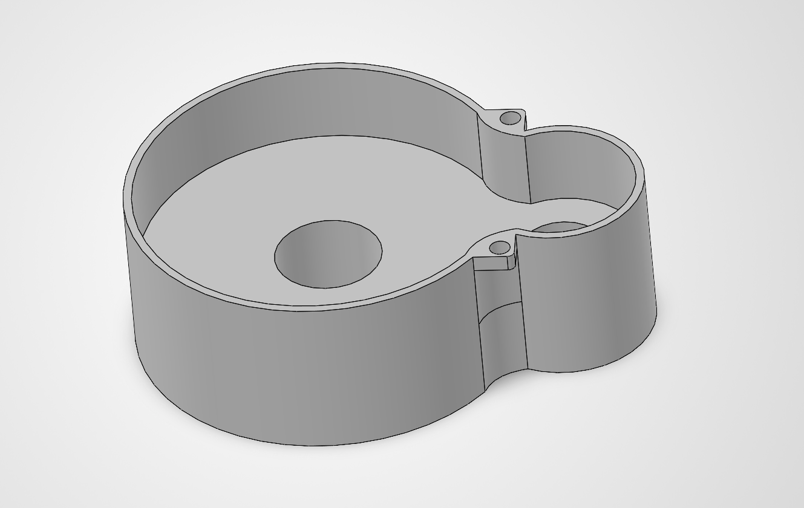

### Assembly

I then put everything into an assembly to make sure everything will fit together. Here is what the design looks like without the top housing part. You can see the bearings, gears, and shaft incorporated into the housing. I used two of each bearing so that the shaft would never touch the housing.

    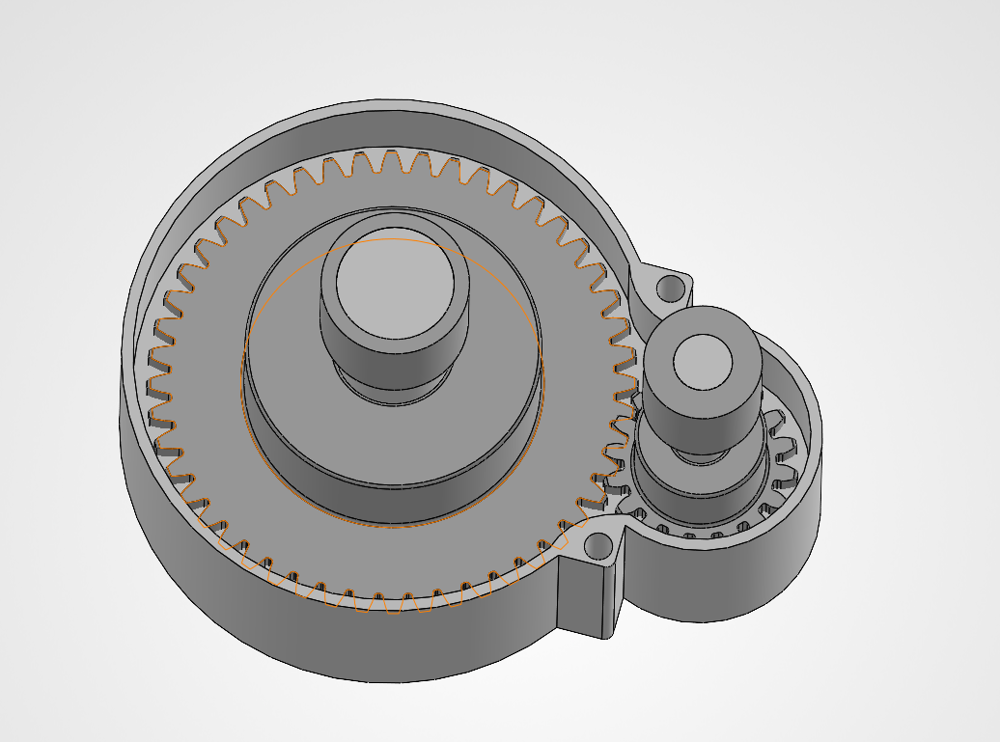

Here is what the final design looks like with the housing completely on.

    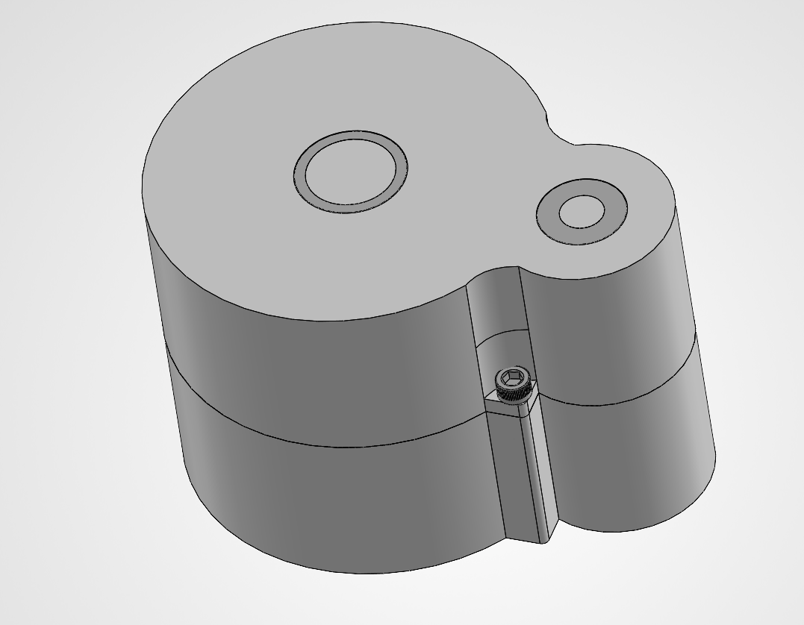

You can see the screws I added with the screw holes. This makes it very easy to assemble and disassemble.

Here is a zip file to all of the CAD files I used for this assignment: [GearBox](GearBox.zip)

## Lessons Learned

I learned a lot about gears and shafts. I learned that gears connected together should share the same if not similar power on each other. I thought that they were supposed to move the same speed, since they were connected together, but my calculations didn't seem to agree with that conclusion. It is most likely due to the fact that I did my calculations wrong. I learned about McMaster Carr Parts. I never knew there was such a widely available website that had very useful parts to download for free. The most important part of a gear setup is the shaft since that is a big part of what is running the whole system. It is also harder to replace than the other parts in the system. It felt like a lot of the designing we did was very focused on the shaft for that reason.

## 2157 Students Only

    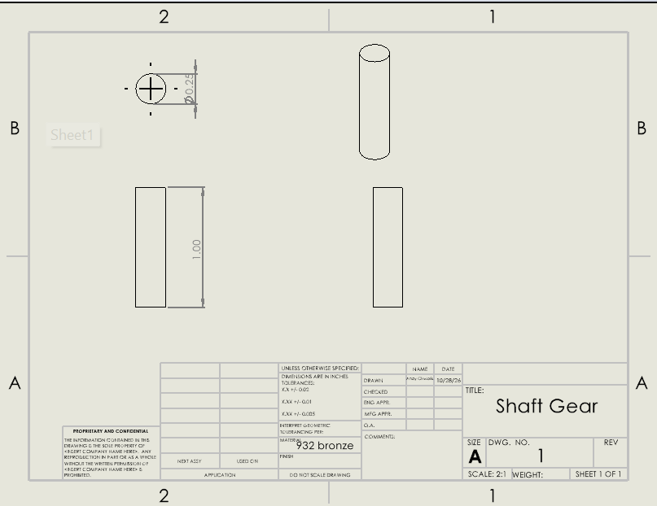

    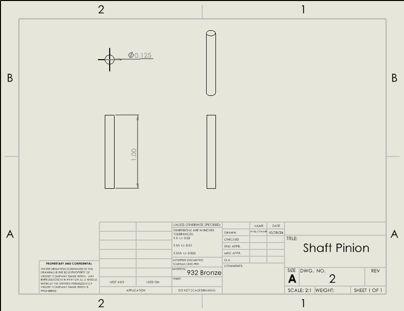

    

    

    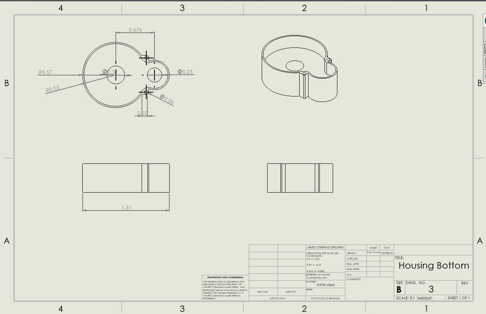

    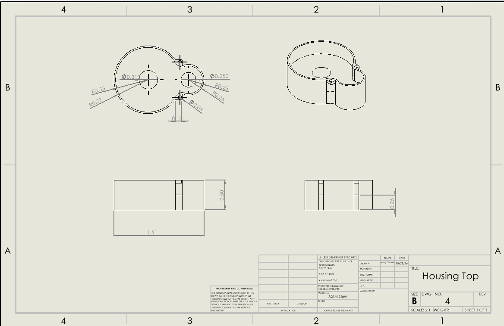

    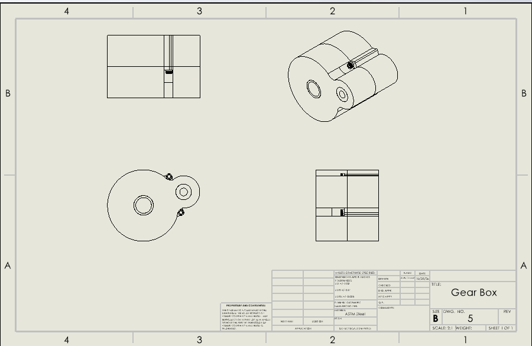

