# A9 – Pulleys

## Objective

Design a pulley system to transfer power between two parallel axes separated by a center distance of 4–6 inches. The system must meet the following requirements:

- Pulley Diameter: Both pulleys shall have a diameter of 3 inches.
- Rotational Speed: Select an operating speed between 1000–2000 rpm.
- Belt Tension (Static): Select a belt tension between 4–6 lbf under stationary conditions.
- Material: Pulleys may be made from aluminum, ABS, or steel, and may include a groove and shaft diameter of your choosing (within reasonable manufacturing limits).
- Safety Factor: The design must satisfy a minimum safety factor of 3.

Assume the belt is made from polyurethane rubber, with a yield strength of 3.25 MPa (471 psi) at 20% strain, based on: Wanga, Chena, Wua, Zhangb, Suna, “Strain-induced Structural and Dynamic Changes in Segmented Polyurethane Elastomers.”

## Analyze

### Belt Design

To start the design for the belt, I needed to solidify my values. For all of the values I had options for, I picked the middle value for all of them. I also decided to make my pulley out of steel, which isn't as important to know for the diameter and circumference for the belt.

#### Knowns

For the knowns, I assumed that the coefficient of friction was 0.6 due to the value in the slides. I didn't realize before I started, but the lecture slides says that that the coefficient of friction for rubber on steel is 0.6. That is why I am using 0.6 for my value. I am also assuming that the wrap angle will always by 180 degrees since the pulleys are the same size and should act as a semicircle for the belt.

    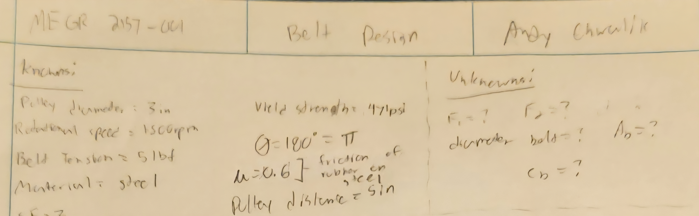

#### Free-Body-Diagram

    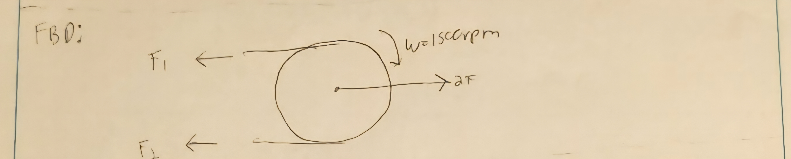

#### Solving Symbolically

I got all of these equations from the lecture slides except for the outer circumference. I wasn't sure how to get the outer circumference, so I decided to look and see what other students have done. I noticed that there was a broad range of equations used, so I decided to ask google. When I searched it up on google, I got the pi x d, which is just the formula for circumference for a regular circle. I saw complex equations from other students, so I decided to ask ChatGPT what the correct formula is. The resulting equation is the answer it gave me.

It is worth noting that this equation assumes that the two pulleys have different values for radius. Since they are the same, I can ignore the last portion of the equation since there would be a zero in the numerator. This leaves me with just C = 2L + pi*D_p.

    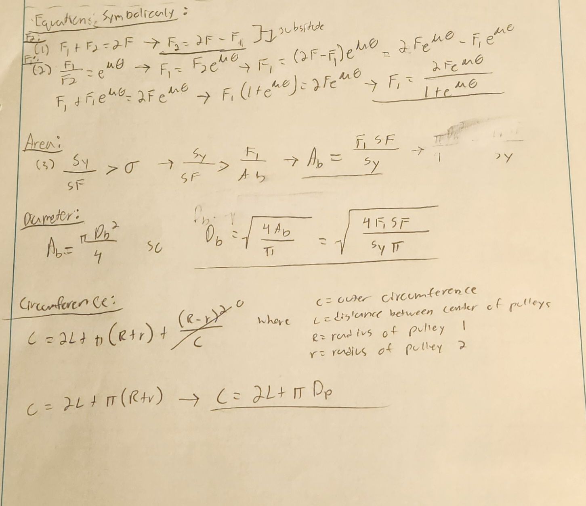

#### Solving Numerically

    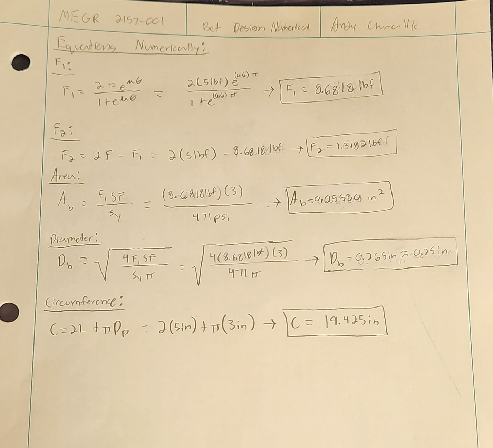

#### Belt Selection

To find the belt I wanted to use on McMaster, I put in the diameter that I calculated for. I didn't want to round my value down to 1/4in, so I looked at the 5/16in options first because that was the closest value to my calculated value. When I was looking at belts with 5/16in diameter, the circumference of those belts were at minimum 24in+. That is larger than I was comfortable with, and I wouldn't be able to reach that value unless I max out all of my variables. 

In result, I rounded my diameter to 1/4in because there are a lot more circumference options at this diameter compared to 5/16in. Once I had my diameter down, I just typed in my circumference value, and this round belt popped up as a result.

    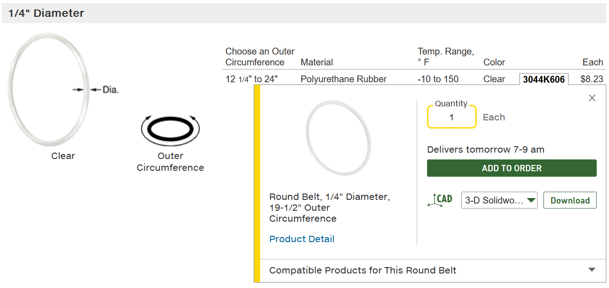

### Shaft Design

To design the shaft, the only new information that I needed to find was the material properties for 1060 hardened steel. There are a lot of different ways to treat hardened steel, but I decided to take the yield strength from this [website](https://www.azom.com/article.aspx?ArticleID=6542).

#### Knowns

    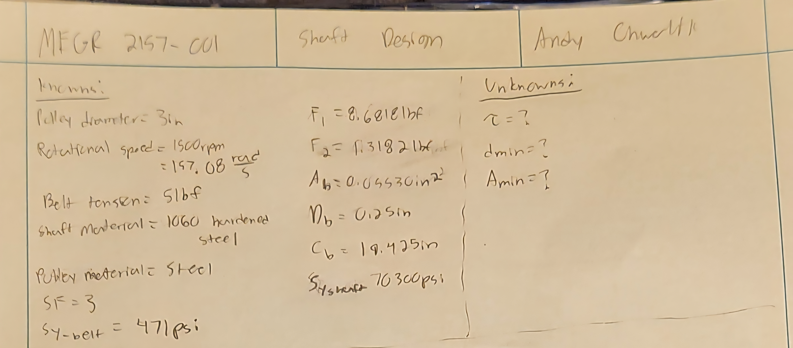

#### Free-Body-Diagram

    

#### Solving Symbolically

I wasn't sure how to solve for area first and then get diameter after solving for diameter, so I solved for the diameter and then the area.

    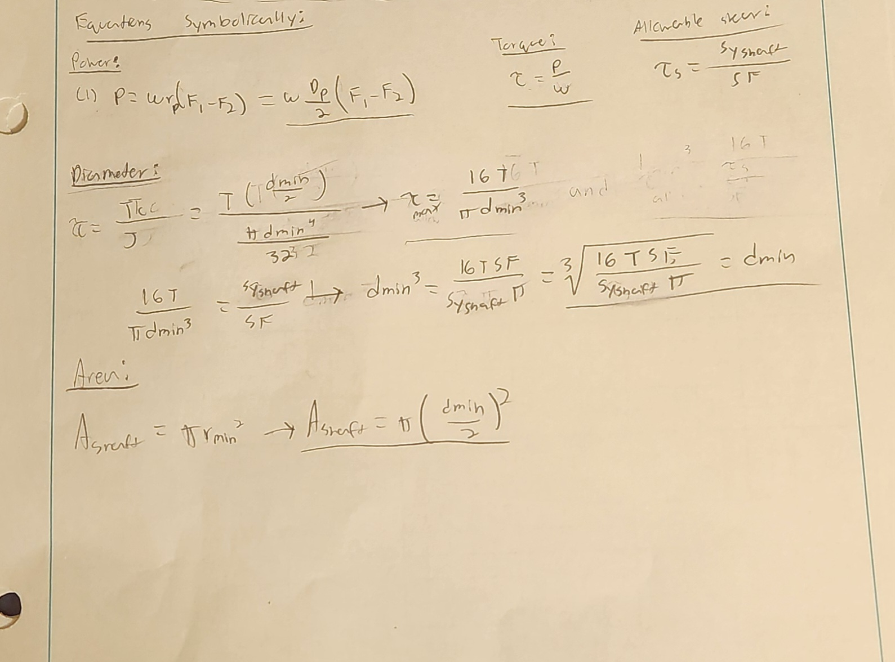

#### Solving Numerically

    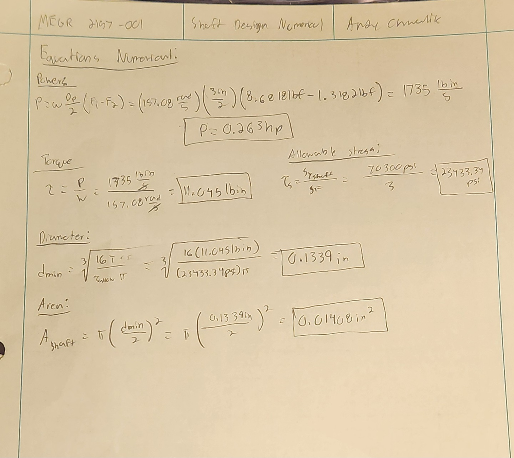

### Journal Bearing Design

The only thing that I needed to do before starting the same process again was pick a journal bearing length. I decided to pick 1in since I thought that would make my math a little easier, and I am pretty sure that is a common length for journal bearings.

#### Knowns

    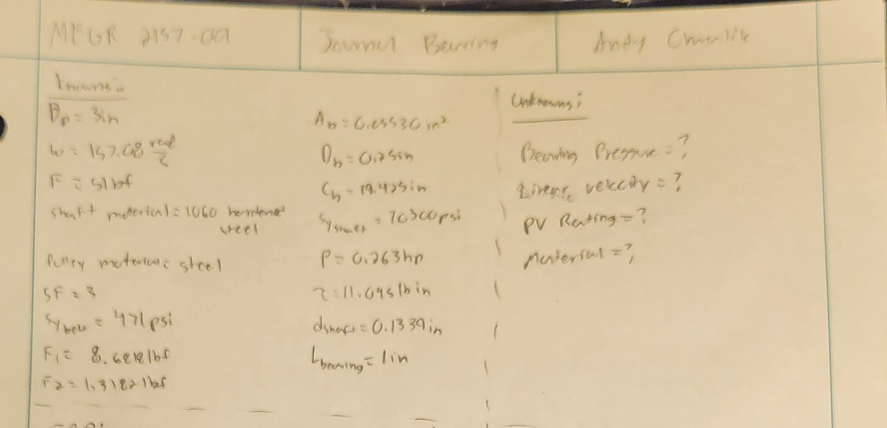

#### Free-Body-Diagram

    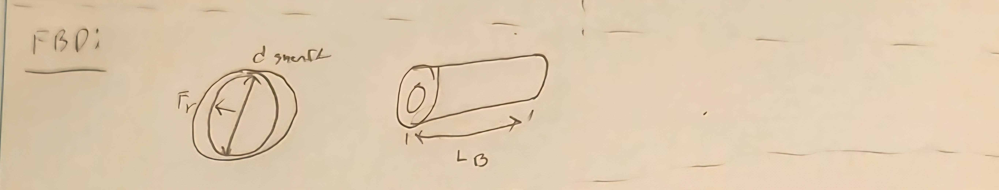

#### Solving Symbolically

The journal bearing had the most simple equations out of the different parts I designed.

    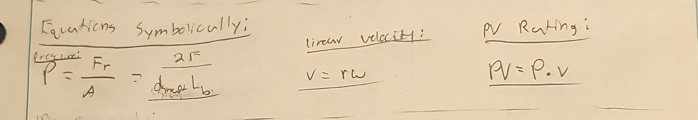

#### Solving Numerically

    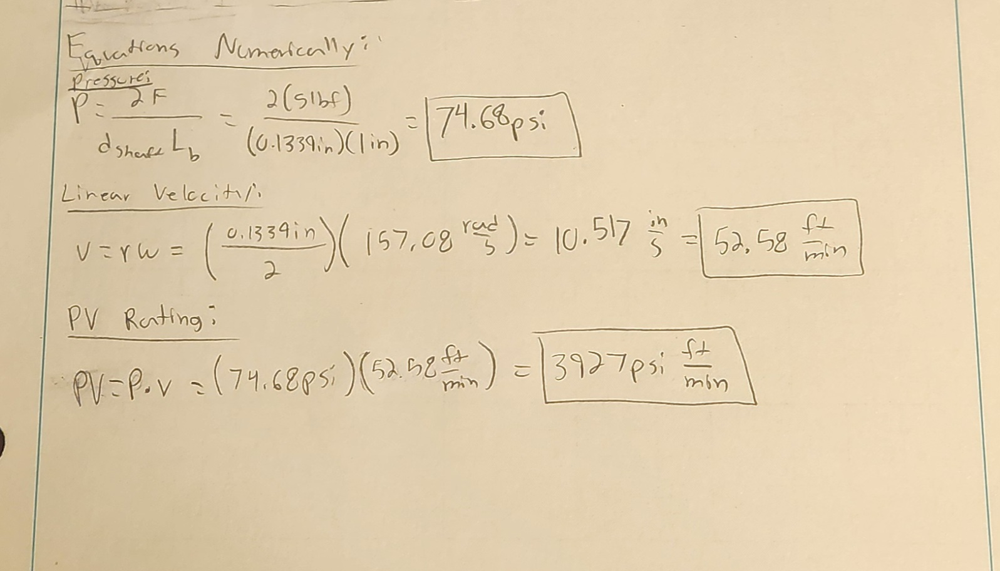

#### Material Selection

When choosing my material, I first looked at what could withstand the pressure put on the bearing. According the table 4, every single material could withstand that except for rubber. Next, I looked at my linear velocity. The only material that this eliminates from the table is Virgin Teflon. I then looked at my PV rating last. This eliminated none of the remaining materials from table 4.

With the remaining materials, it seemed like the material with the lowest values, which I am assuming means that it is cheaper, is graphite (lubricated and dry). For journal bearings, I am assuming that I would want to pick the lubricated journal bearing over the dry journal bearing to reduce friction and possibly heat. Looking at the max temperature, it doesn't seem like heat would be an issue, but it still good to keep in consideration.

    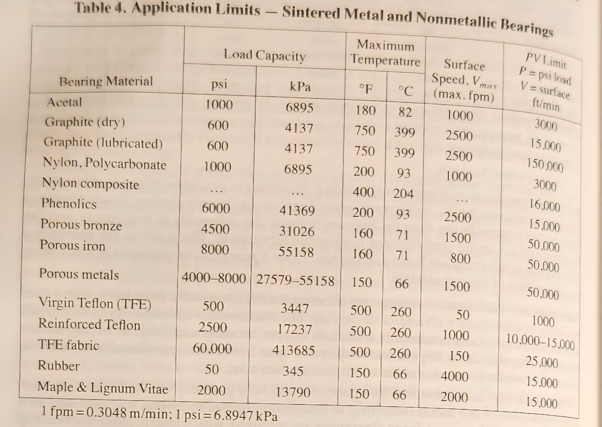

### Frame Design

I took inspiration from appendix A in the assignment for my frame. I am not sure how much clearance there is supposed to be with the belt to the walls of the pulley, so I made the gap for the belt a quarter of an inch. If I am informed later that it needs a larger clearance, I can increase that size

From my experience, the walls holding the belt aren't super thick. that is why I made the total length of that side only 3/8 of an inch. I think it should be plenty of material seeing how it is made of steel. Similar to the clearance for the belt, I can change this quickly if that is not the case.

For the total length of the frame, I added the diameter of the pulleys to the distance between there center points. This should have gotten me to the edge of the pulley. I then added 2 times the diameter of the belt since that will add extra length to the pulleys. I didn't want the belt to slip, and fall off the frame, so I made sure to add enough material so that won't be a problem. I may have to decrease this value to be closer to the true length of the pulley + belt since it will be really hard to do maintenance on that pulley without a latch of some kind.

The last dimensioning I really made was make the holes in the pulley the same size as the shaft so that the shaft can attach to the frame. I didn't write it on the drawing, but there should be a clearance for this since I doubt the exact dimensions will be met every time. The tolerance I will put on it is + 0.01in.

    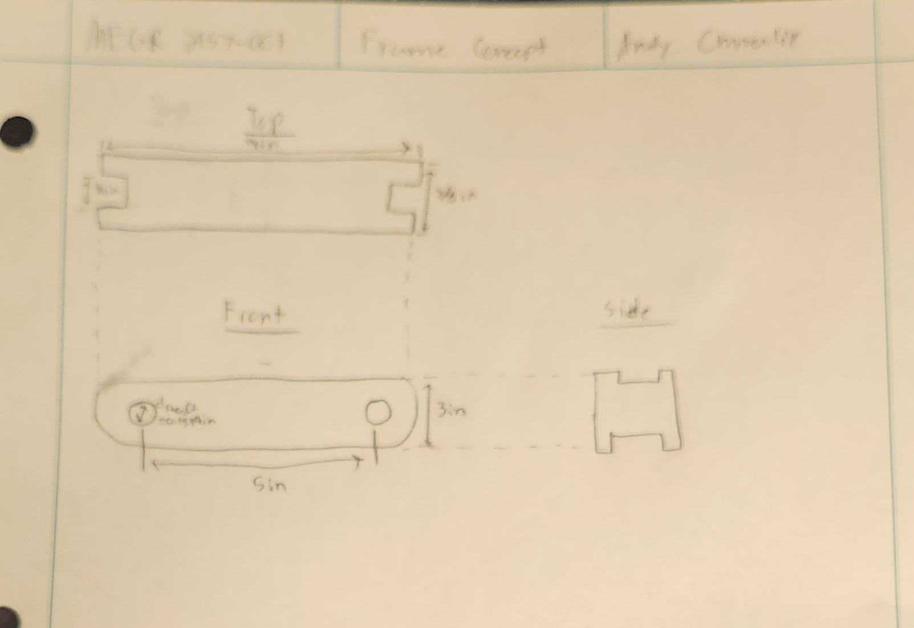

## Lessons Learned

I learned a lot during this assignment. The most interesting thing that I learned was the equation for friction on a pulley. In all of my classes, I have ignored that aspect of a pulley, so it was interesting to hear about how it works and what the different variables do to alter the equation. That was one thing that I actually asked about after the lecture was over. I also haven't really worked with torque before, although I probably should look into more projects involving torque. So I learned how to use it to find power and the diameter of some cylinder. Most of the stuff I learned dealt with rotational motion. I have noticed that whenever you convert from linear to rotational, you tend to just multiple the rotation value by the radius to get the linear value. The reverse is true if you're trying to find rotational motion.

This assignment took my about 6 hours
