# A10 – Lead Screw Design Part I

## Description

A tensile tester is a mechanical testing device used to measure how materials respond to uniaxial tension. It applies a controlled pulling force to a specimen while recording the resulting elongation, allowing engineers to determine properties such as yield strength, ultimate tensile strength, and elongation at break. This data is essential for understanding a material’s mechanical behavior and suitability for design applications.

Design and build a mechanically driven tensile tester capable of applying up to 2 kN axial tensile load with a controllable crosshead speed from 1 to 50 mm/min. Each team is responsible for the mechanical components outlined below. The system will provide consistent, well-aligned loading for polymers and light metals, suitable for instructional use and basic materials evaluation.

## Objective: Part 1 Scope of Work

- Develop a lead-screw–driven crosshead 
- Ensure accurate, repeatable load application to 2 kN with minimal crosshead deflection and misalignment.
- Provide robust specimen gripping, simple calibration provisions (mechanical), and safe, ergonomic operation.
- Key Constraints
- No electronics, no software

## Key Constraints

- Load capacity: 2 kN (with appropriate safety factor in structure and drivetrain).
- Speed range: 1–50 mm/min (achieved via screw lead selection).
- Form factor: bench-top footprint favored; manageable overall height; 18-inch leadscrew minimum.
- Safety Factor: 4

## Lead Screw Minimum Diameter:
Alinah’s part: 
For this assignment, I worked on selecting a lead screw that could safely support a 2000 N load using two screws. I started by calculating the minimum diameter needed with a safety factor of 4, then calculated the rotational speed range and torque required to lift the load. Below are the two images of my work in how I accomplished it. In some of the math I used in assumed geometry based off the screw I knew I wanted to later choose, this is within the documented work. 

After I had to analyze whether the selection of screw I made would actually work. I chose the 3/8"-16 lead screw off of the provided McMaster link. I made sure to check the total stress that the screws would face with the axial load of 2kn. The safety factor of our design with my selected lead screws needed to be above the minimum safety factor of 4. One mistake I made was forgetting to check for buckling at first, so I had to go back and complete those calculations. Luckily, my screw still passed the buckling check with a safety factor above 4. These calculations are shown in the image below:

 

## Nut and Flange

After finishing the design for the lead screw, we had to make sure the nut and flange could take the stresses that we designed for. The assignment says to use the formulas that are in the lecture slides, so I went back to the lecture slides to see which equations it was talking about. When I looked at the slides, it seemed like it wanted me to calculate the bearing stress, shear stress, and bending stress. All of the variables used in these equations were already calculated from the lead screw, but I was a little confused with the d_min variable. We calculated a d_min, but that was relating to the minimum diameter of the screw before it failed. The d_min used in these equations represents the minor diameter, which is the diameter of the thinnest part of the thread. I wasn't sure what to use for this value, but when I asked ChatGPT, it told me that a common value for the type of lead screw we were using was 0.2983in. That was the only value I really had to do my calculations with, so that is where I got that value and why we used it.

We were told to use 673 Bronze, also known as C673 manganese bronze, for the nut, so I had to look up the mechanical properties for that material. I used [concast](https://www.concast.com/c67300.php) to find my mechanical values for the calculations while I used [OnlineMetals](https://www.onlinemetals.com/en/product-guide/alloy/673) for the 3D modeling because I couldn't find all of the mechanical properties I needed for the 3D model.

### Knowns and Unknowns

    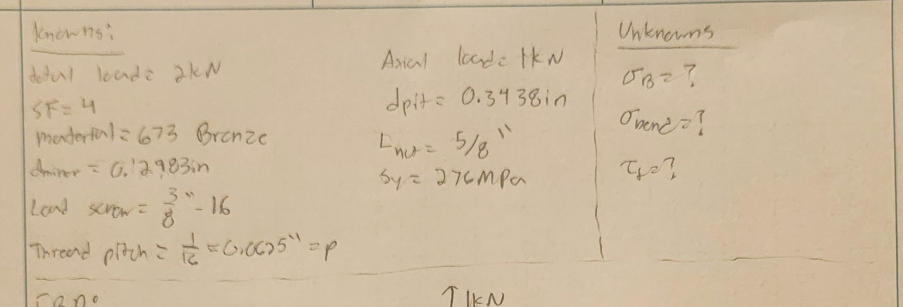

### Free-Body-Diagram

There aren't many forces that are acting on the nut and flange. The only force that I could think about was the 2kN load, which gets divided into 1kN between the two nuts and flange, and the rotational force/speed caused by the motor. We aren't worrying about the motor in this part of the project, so I didn't worry about that value as much.

    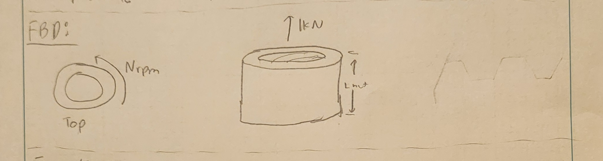

### Bearing Stress Test

I decided to calculate the bearing stress first, mainly because that was the first stress that was shown in the lecture slides. I first calculated the bearing stress and then I compared it to the allowable stress. The calculated bearing stress is much lower than the allowable stress, having a true safety factor of 60.13. This means that the nut and flange pass this part of the test.

    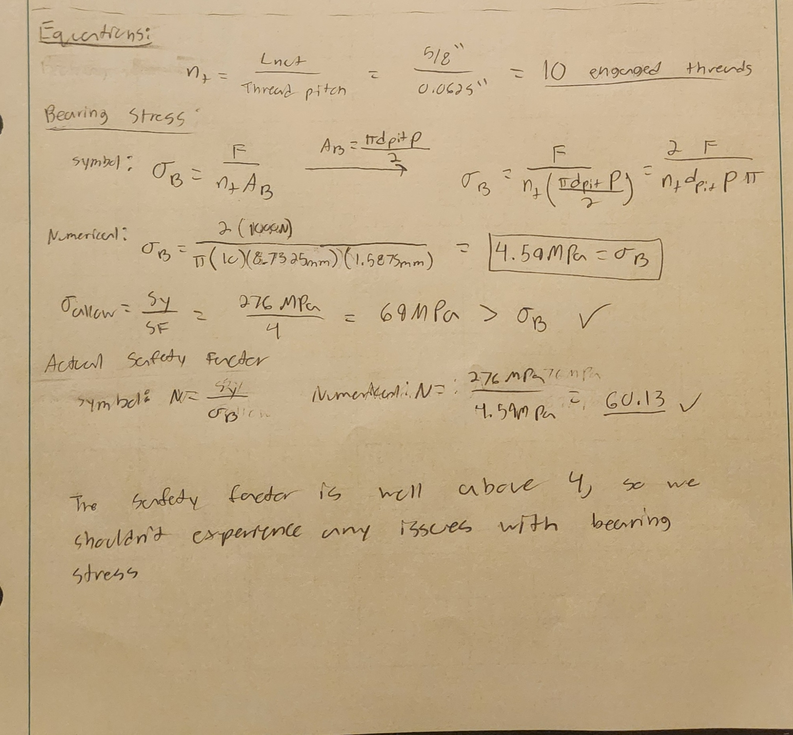

### Bending Stress Test

I then decided to calculate bending stress. I followed the exact same process as I did for bearing stress. My calculated bending stress is 15.89MPa. When I use this value to find the actual safety factor, it ended up being way above again at 17.37. The nut and flange pass the bending stress test.

    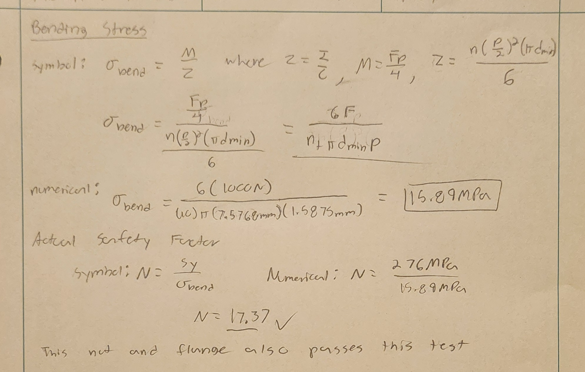

### Shear Stress Test

Lastly, I calculate the shear stress. I decided to add the cross-sectional area to show how I calculated the area. This diagram was also from the slides. I followed the same process as above. My calculated shear stress is 6.9MPa. I couldn't find the actual safety factor because I couldn't just use my yield strength like the previous problems. Since this is shear stress, I have to use the shear yield strength. To do this, I just divided the yield strength by sqrt(3). I then used those two values to find my actual factor of safety which turned out to be 23.1.

    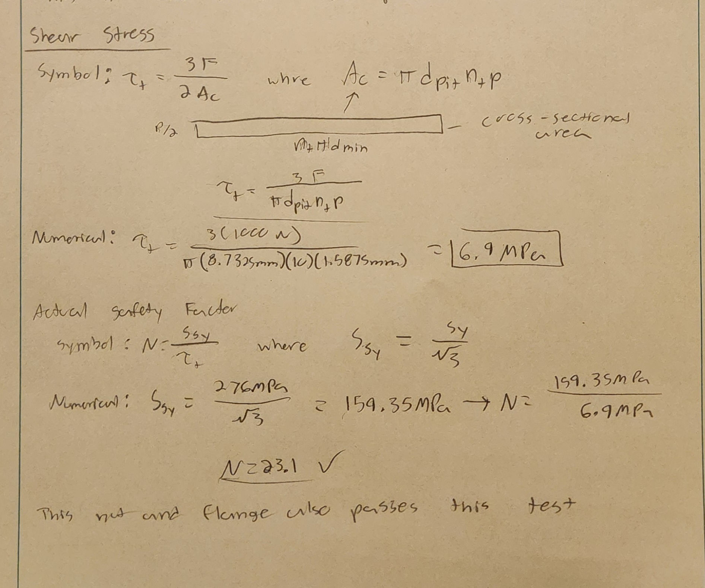

The nut and flange passed all of the tests with a pretty good margin, so we are good to use our lead screw, nut, and flange.

## Design the Crosshead:

### Beam Stress/Strength Analysis:

### Beam Deflection:

### Multiview Sketch:

## Tabulating Costs

    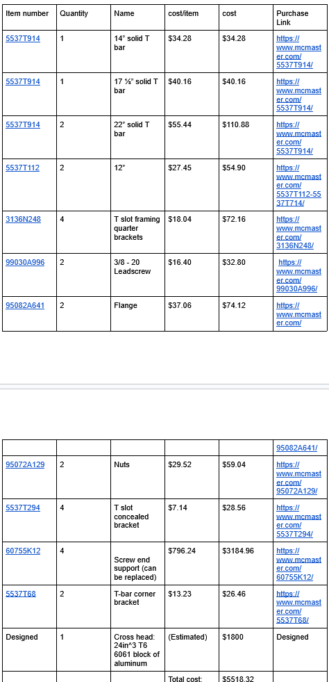

## CAD Modeling

I decided to model the crosshead first and then download all of the part files after. There isn't a reason for doing it in this order.

### Crosshead

Before I start modeling the crosshead, I created global variables for the dimensions that area listed in the crosshead drawing. This way we can go back and change the crossheads design really easily.

    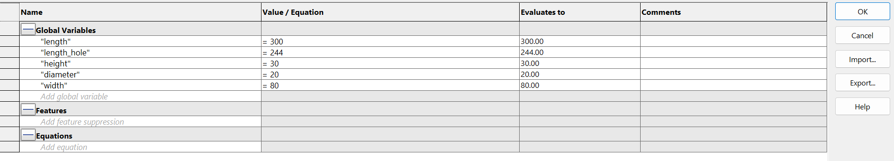

<table style="width:100%;">
  <tr>
    <td style="width:60%;">
      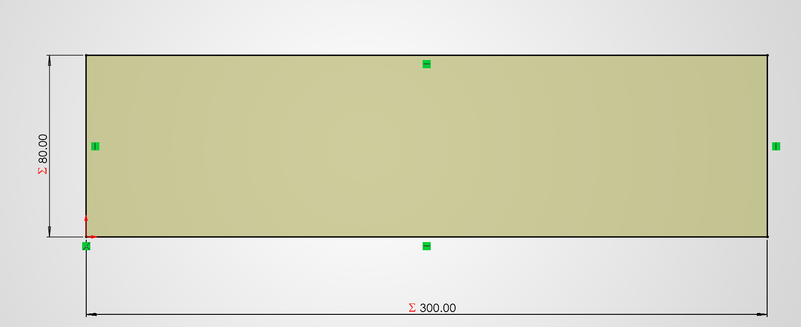
    </td>
    <td style="width:40%; padding:28px; text-align:center; vertical-align:middle;"">
      

        The crosshead looks like a box with two screw holes in it, so I decided to sketch an outline for the box. I assigned the length and width global variables to there respective spots.
      

    </td>
  </tr>
  <tr>
    <td style="width:60%;">
      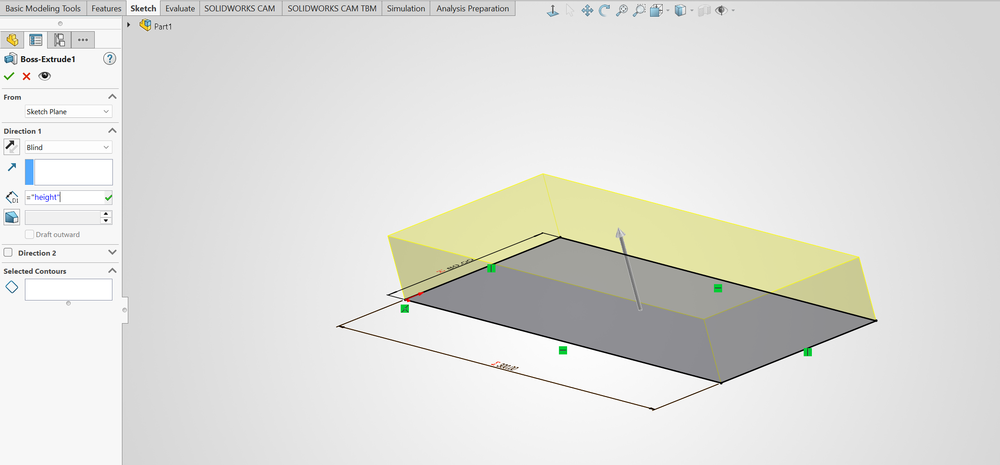
    </td>
    <td style="width:40%; padding:28px; text-align:center; vertical-align:middle;"">
      

        I then extruded the sketch by the height global variable to create the main shape of the crosshead.
      

    </td>
  </tr>
  <tr>
    <td style="width:60%;">
      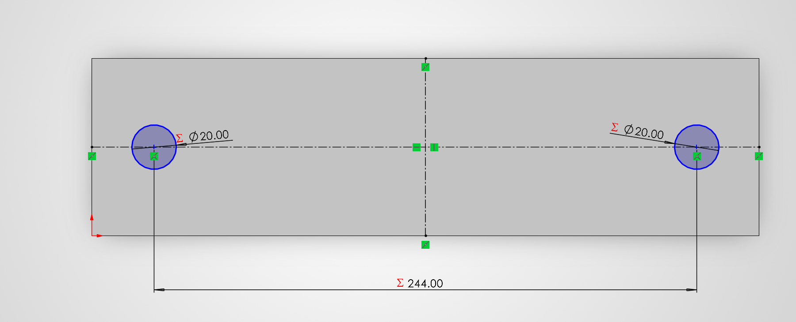
    </td>
    <td style="width:40%; padding:28px; text-align:center; vertical-align:middle;"">
      

        To create the two holes in the box, I created a sketch on the top of my box and then created a centerline long ways. That way I could start my holes in the middle of the crosshead. I assigned the diameter variable to the two circles on the sketch and then made sure to separate them by the respective global variable. 
      

    </td>
  </tr>
  <tr>
    <td style="width:60%;">
      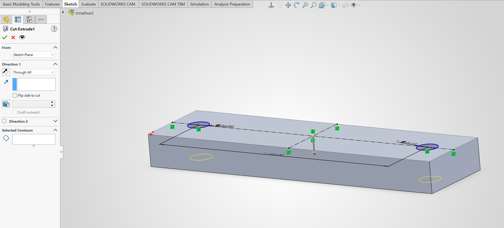
    </td>
    <td style="width:40%; padding:28px; text-align:center; vertical-align:middle;"">
      

        Once I had the sketch for the two holes, I just extruded the sketch through the crosshead. This finished the shape of the crosshead.
      

    </td>
  </tr>
</table>
    
The material we are using for the crosshead is 6063 - T6 aluminum, which is already in SolidWorks base materials. This made it super easy as I just selected their default material rather than making a custom one.

### Frame Assembly

When I first start designing the full assembly, I downloaded all of the parts I knew we were using from our calculations. This included the lead screw, nut, and flange. None of the materials for the parts were imported, so I had to manually assign materials to them. For 1018 low carbon steel, I used [World Material](https://www.theworldmaterial.com/astm-sae-aisi-1018-carbon-steel/) for the mechanical properties. For 673 bronze, I used [concast](https://www.concast.com/c67300.php) and [OnlineMetals](https://www.onlinemetals.com/en/product-guide/alloy/673) for the mechanical properties as stated earlier. For 1215 carbon steel, I used [AzOM](https://www.azom.com/article.aspx?ArticleID=6603) for my mechanical properties.

<table style="width:100%;">
  <tr>
    <td style="width:33%; align="center"">
      

        <b>1018 low carbon steel properties</b>
      

      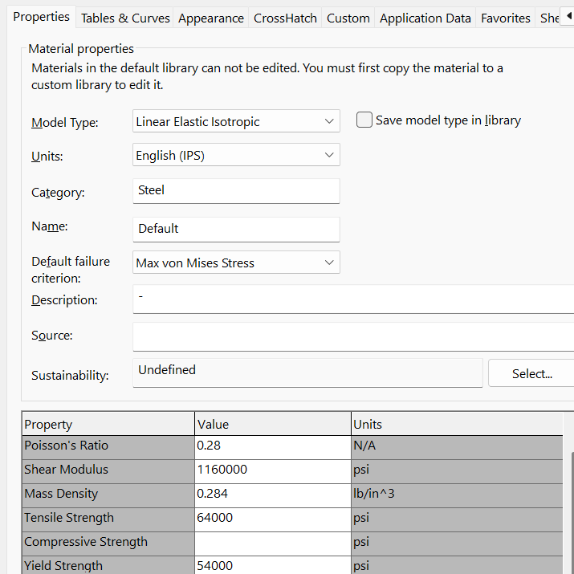
    </td>
    <td style="width:33%; align="center"">
      

        <b>673 Bronze properties</b>
      

      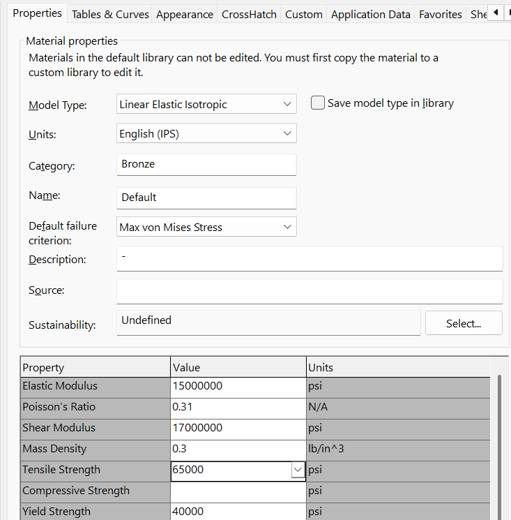
    </td>
    <td style="width:33%; align="center"">
      

        <b>1215 carbon steel properties</b>
      

      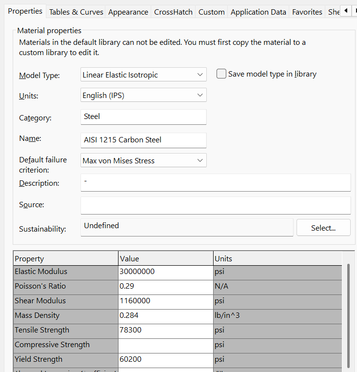
    </td>
  </tr>
</table>

After creating the materials, I tried to make the tensile tester using just these parts. I found it very difficult since it was hard to mate the components I had to each other. I decided to move onto picking t-bars because I thought that would give me a better structure to build from.

#### T-bar choice

Looking at the references in the assignment document, I saw that they used a solid 6 slotted t-bar. I also saw that they had 10ft and 20ft bars selected for some reason. I wasn't sure why those were the selected distances at first, but I thought that meant we also had to use the same distances. This was a big mistake for multiple reasons, but the main reason is because of the t-bar I ended up downloading. I didn't see many t-bars that were that long, so I went to the custom t-bars and downloaded that file. I was then using this t-bar to assemble the entire frame. What I didn't notice before I used it was the t-bar wasn't completely flat. It was rounded in crucial spots, which made the frame really crooked. It was also a nightmare to mate everything due to the weird geometry.

I did correct this mistake by downloading the 1ft bar and then changing the length of that bar inside SolidWorks to the different lengths. I then downloaded the changed distances as separate CAD files so I could use all of them inside of the assembly. I used the custom length bar on McMaster to estimate a price for the new distances I was creating with the 1ft bar. I did something similar with the custom bar download, but the 1ft bar is much straighter. You can see the comparison in the image below.

<table style="width:100%;">
  <tr>
    <td style="width:50%; align="center"">
      

        <b>Custom Length T-Bar Top View</b>
      

      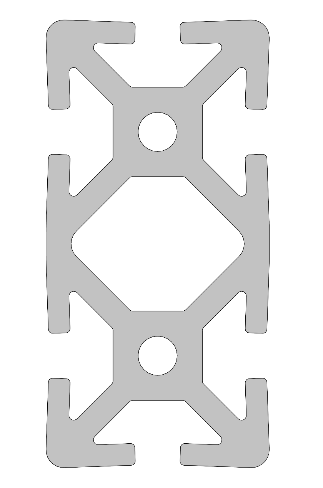
    </td>
    <td style="width:50%; align="center"">
      

        <b>1ft Length T-Bar Top View</b>
      

      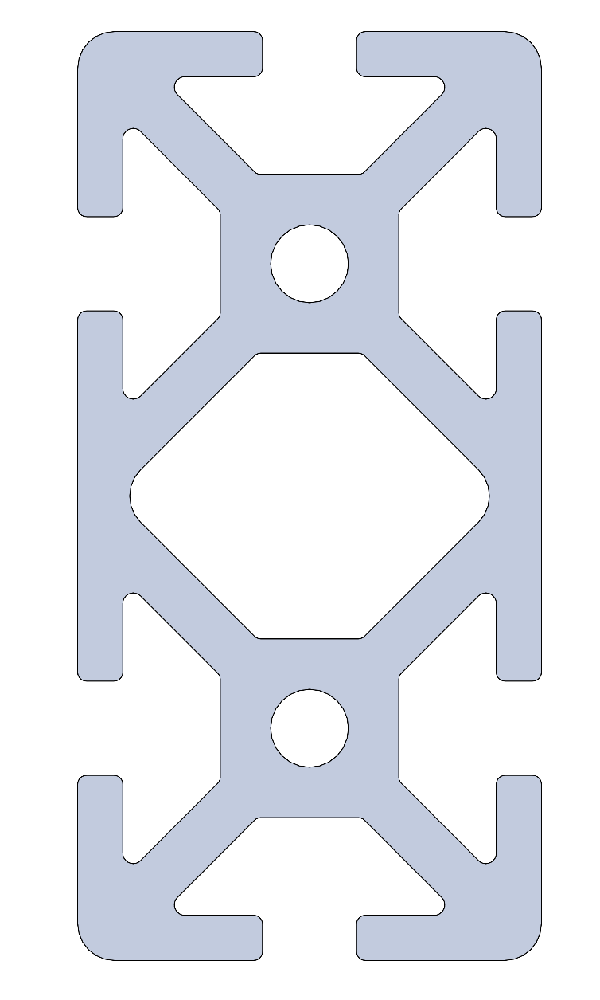
    </td>
  </tr>
</table>

The material didn't translate to the t-bar in the download, so I had to apply the material manually to each file. McMaster says that this type of t-bar uses anodized aluminum, which is just aluminum with a special coating. When I researched what type of aluminum I should use, I found out that I could just use the same type of aluminum I used for the crosshead. So, I applied the 6063 -T6 aluminum to all of the t-bars.

#### Connections

The next big hurdle I had to tackle was how all of these t-bars were going to connect. I could just mate them on the sides and forget about the connections, but that doesn't seem like what we are expected to do for this assignment. 

##### Elbow 

The first connection that I added to the assembly was the elbow, connecting the vertical t-bars with the horizontal t-bar holding the loading cell. I saw that the image in the assignment used a gusset, but I wasn't sure if I would have enough space for that. That is why I used an elbow connection. 

The elbow connection I downloaded had these trapezoidal pieces on it with screws attached to them. The design is to slide those trapezoidal pieces down the t-bar and then screw in the screws to keep the t-bars in place. I thought that this would be a good use of this design since that is how the two t-bars are intersecting. It will provide a little bit of support while making sure nothing is moving.

<table style="width:100%;">
  <tr>
    <td style="width:50%; align="center"">
      

        <b>Elbow Connection</b>
      

      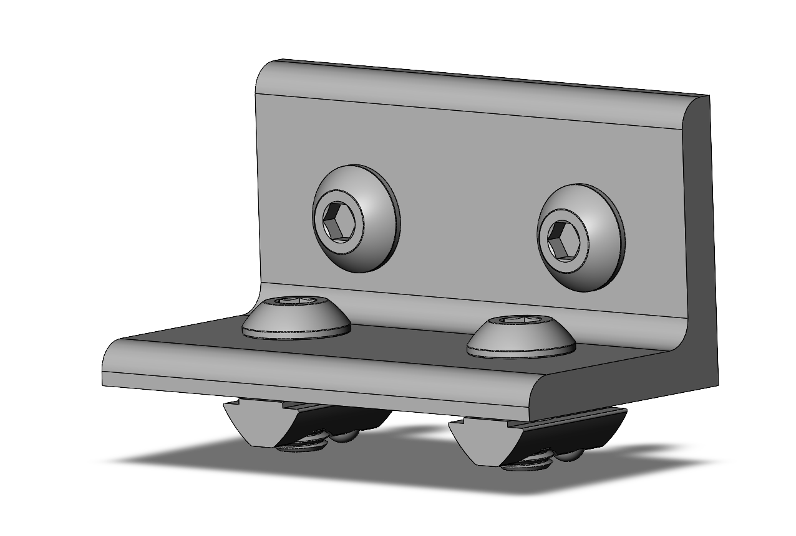
    </td>
    <td style="width:50%; align="center"">
      

        <b>Trapezoidal Connection to T-bar</b>
      

      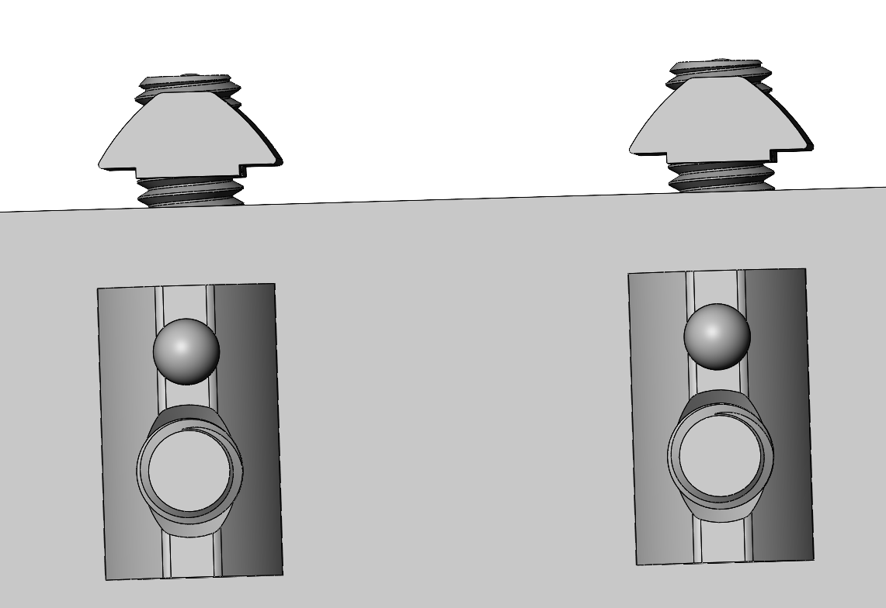
    </td>
  </tr>
</table>

The material didn't transfer over again, but the website says that it uses powdered-coated aluminum. I took this as surface finish again, so I assumed that the bulk of the material is still the same as the crosshead and the t-bars, so I made the material 6063 -T6 aluminum to both of the connections.

##### Concealed Set Screw Corner

The second connection I wanted to apply was the connection with the vertical t-bars and the base t-bars. I was looking at the picture in the assignment, and I didn't really see a connection. This confused me, but I figured out that there are concealed connections. I was looking at corner connections, and found this concealed set screw corner connection. It uses a very similar mechanic as the elbow connection with the trapezoidal pieces, so I thought that it would be good for this connection. I decided to put these connections on both sides of the vertical t-bar because I thought it would make the machine more durable and sturdy. 

Similar to every other CAD file I have downloaded while making this project, the material didn't download with it. Looking at McMaster, it says that it is anodized aluminum, so I applied the 6063 -T6 aluminum to this connection.

<table style="width:100%;">
  <tr>
    <td style="width:50%; align="center"">
      

        <b>Concealed Set Screw Corner Connection</b>
      

      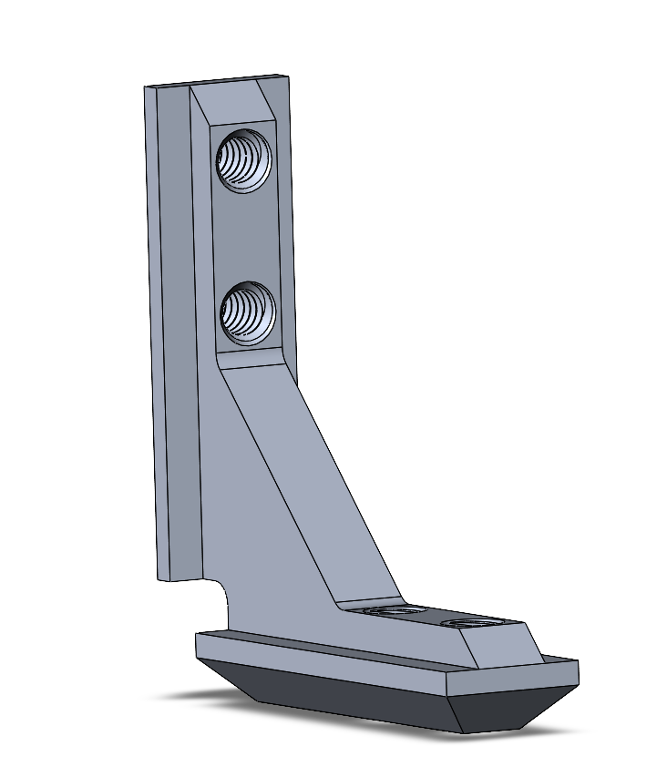
    </td>
    <td style="width:50%; align="center"">
      

        <b>Concealed Set Screw Corner Connection on Frame/b>
      

      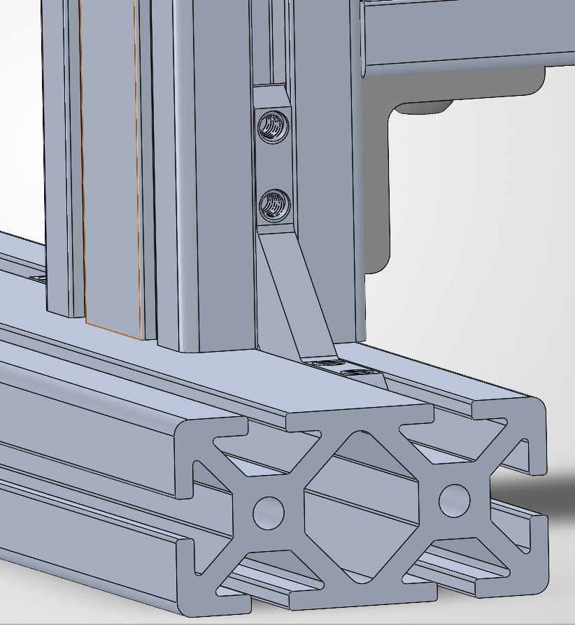
    </td>
  </tr>
</table>

##### Concealed Set Screw Straight

The previous connections I used are able to connect the entire base of the frame. I now need a connection that will connect the vertical t-bars with the t-bar going over the top. I wanted to keep using the concealed connections, since that is most similar to the picture in the assignment. I didn't want to use the same connection because the lead screws will have to connect pretty close to the edges of the frame. I didn't want the connection to interfere with the lead screw.

I found a concealed screw that uses the same mechanics as the other connections but for a straight connection rather than a corner. This will allow me to connect the frame on the outside rather than using the corner connection on the inside of the frame. I used four of these connections because I needed two on each side due to the double t-bar. Connecting the top t-bar this way should lock the frame into place.

<table style="width:100%;">
  <tr>
    <td style="width:50%; align="center"">
      

        <b>Concealed Set Screw Straight Connection</b>
      

      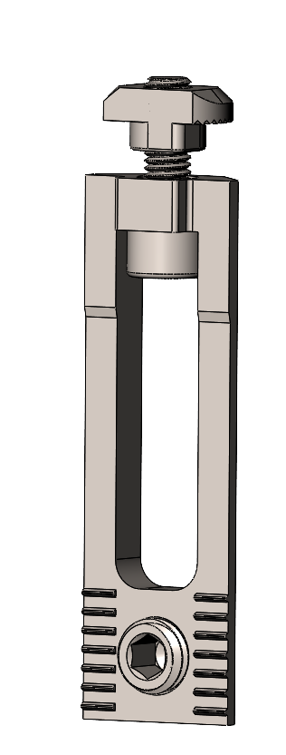
    </td>
    <td style="width:50%; align="center"">
      

        <b>Concealed Set Screw Straight Connection on Fram</b>
      

      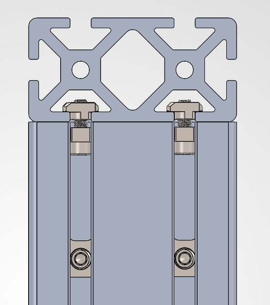
    </td>
  </tr>
</table>

The material didn't import again. Looking at McMaster, it uses zinc-plated steel. This is similar to the anodized aluminum but for steel. When I looked up what material would best fit this, I found that 1018 low carbon steel would work just fine. Since I created the material for it earlier, I decided to apply that to this connection.

##### Lead Screw End Support

The last connection that I needed to find was for the lead screw. There aren't any holes in the t-bars, and it looks like there is some sort of connection in the picture shown in the assignment. I have no clue how to look for these connection parts, so I just put my lead screw into ChatGPT and asked for it to find a connection I could use for t-bars. It gave me a link to one that only resisted the radial direction, so I looked for one that resisted radial and thrust. I am pretty sure that it will have to do both for a tensile tester.

<table style="width:100%;">
  <tr>
    <td style="width:50%; align="center"">
      

        <b>Lead screw end support</b>
      

      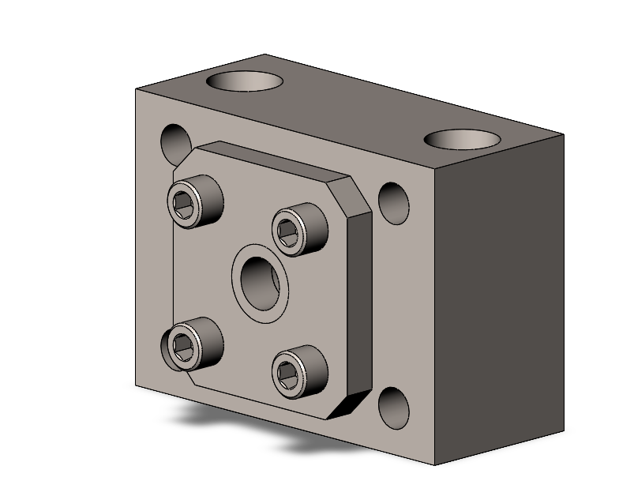
    </td>
    <td style="width:50%; align="center"">
      

        <b>Lead screw end support connection</b>
      

      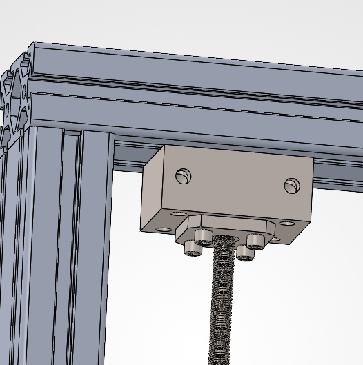
    </td>
  </tr>
</table>

### Final Design

After I connected and mated everything, here is the final design for the first part of the tensile tester.

    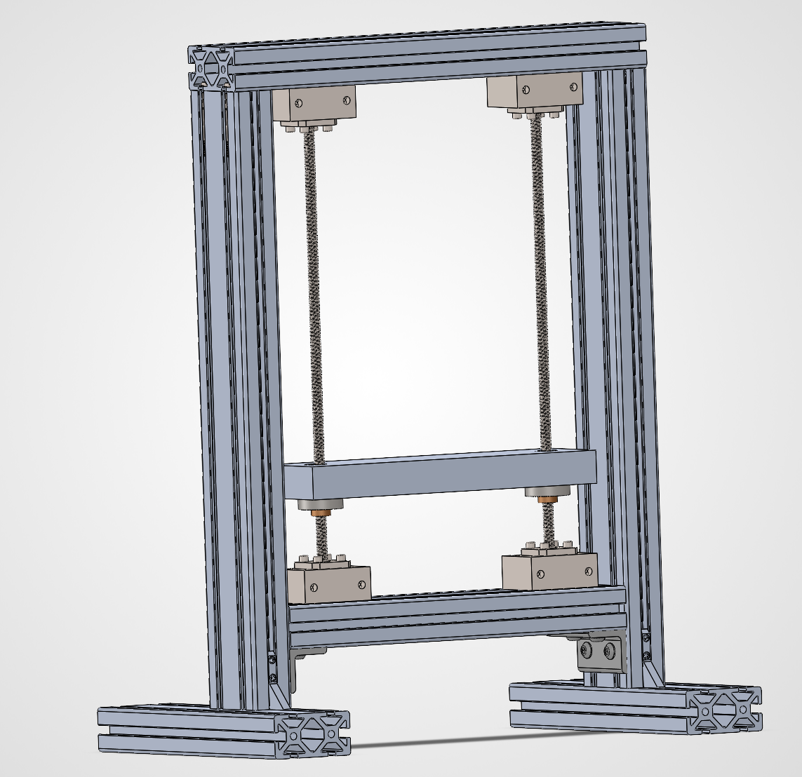

If you are interested in the CAD files, here is a [zip file](tensile_tester.zip) that has the assembly with each component in it.

## Lessons Learned

For this project, I was assigned to check the nut and flange and do the CAD work for the tensile tester. While checking the nut and flange, I learned how to use the 3 new equations to check for design constraints. We have used variations of those equations in the past, but I learned how to use them for objects that have threads. I learned a lot while CAD modeling. The main thing I learned were all of the different connections that you can use for t-bars. The main connection that I really liked messing with, and seeing how it would look incorporated into the design, are the concealed connections. Concealed connections are really interesting because they provide a really strong connection to the t-bar, while barely being noticeable. I learned they are used on a lot of different designs. I also learned that fasteners are one of the most common connection methods even though I didn’t use them in this CAD design. I never understood how the fasteners would connect in the CAD file.

## 2157 Students Only

We first ran a FEA test with medium mesh to get the results of the original design before we optimized anything. 

### Setup

    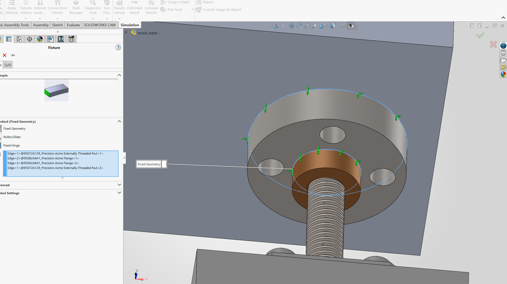

    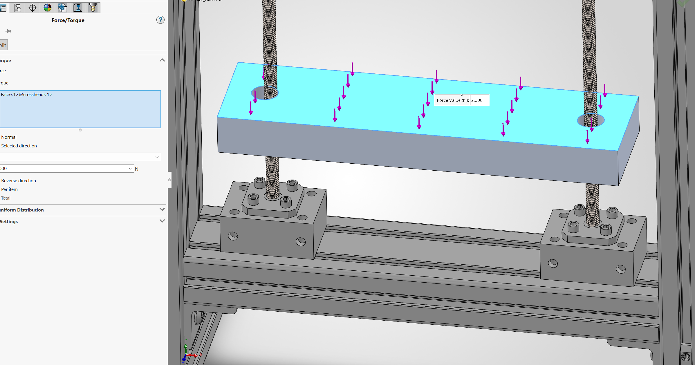

    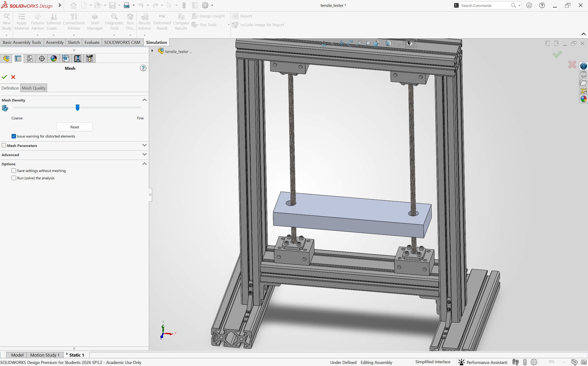

### Deflection Graph

    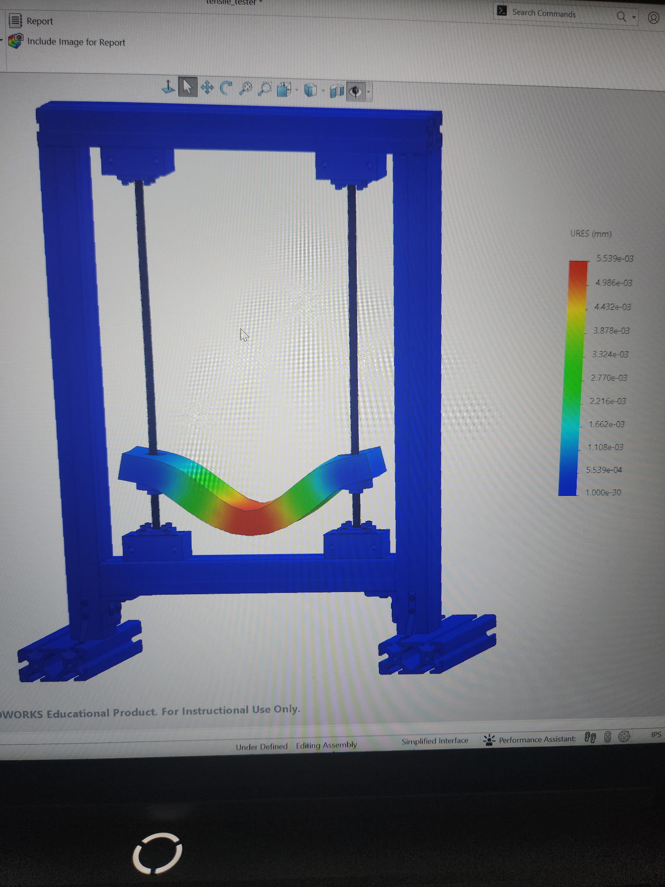

However when we tried to run more tests on solidworks it informed us that 62 elements on the downloaded CAD files have too small of radii for the software to complete the mesh. This created a halt in the optimization process. The above picture is the deflection data gathered from the first run. 

### Crosshead Drawing
[Crosshead Drawing:](crosshead.SLDDRW)

This assignment took me about 20 hours to do
