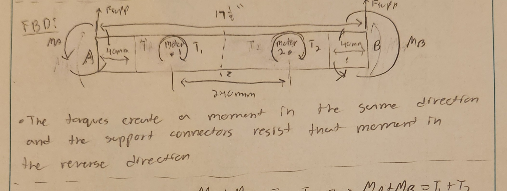

# A11 – Motor Selection
## Analyze and Design the Frame

### Knowns

My first task was to find out how much torque is applied on the top of the frame by the motors we added to the design during this part of the project. To do this part, I used the torque designed variable from Alinah and then the dimensions from the crosshead. The lead screws should be in the middle of the holes created by the crosshead, so I will use that same 240mm measurement between the two. 

    

### Free-Body-Diagram

The free-body diagram was a little challenging for me to figure out, but I drew out a bar that was the same length as the top of the bar on our tensile tester. I then put the two motors where the lead screws are to generate torque. The torque from the motors should be in the same direction as each other since they will either be lowering or raising the crosshead together. To counteract this torque, there are moments created on the sides of the frame. These moments will be going in the opposite direction of the torque to keep everything static. From my understanding, this is all that is happening on the top of the frame

    

### Calculations

To calculate my values I just did sum of the moments. My findings from doing this calculations is that the moments on the outside of the frame are proportional to the torque generated from the motors. This makes sense, since the force to counteract the torque will have to be the same if we don't want anything to move. Once I had the moments, I looked for the load induced by the torque. Using the torque equation, I found what would be the force by itself. I then divided this by the number of supports we were thinking of having. Since the design we made in part 1 has four different connectors, I decided to use that many connectors. I then used this force value to help find the shear across an M5 screw, since that is the screw used in the connectors we already have. I got really low values for the shear and force, so I probably did something wrong. I am not sure what I did wrong, so I am going to be using those values as is.

    

### Connector Choice

Once all of those calculations were done, I had the values I needed to start looking for a connector. When I was looking on McMaster, I couldn't really find anything that had a load capacity on there. When I asked AI for its thinking, it kept suggesting brackets that wouldn't work or also didn't have a visible load capacity on the website. Since the values I found are really small, I decided to keep the same connectors we already had on the frame. Each of them have to hold such a small amount of force, and the material properties should be plenty strong enough to hold everything together.

    

### FEA Analysis

The next step was to simulate the connector that we picked out with the frame. 

#### Top Frame

