# A11 – Motor Selection

For this part of the project, I needed to find two motors that could provide enough torque to move my leadscrews while staying within the required speed range of 1–50 mm/min. Since my design has two leadscrews, I decided to use one motor for each screw. From my previous calculations, I found that each screw needed 2.11 N·m of torque. After using my safety factor of 4, I got a required torque of 8.44 N·m per motor. I also reused my speed calculations that were a range of 0.625-31.5 rpm. These helped me select a motor from McMaster. Below is my work:

After looking through different motors on McMaster, I decided to go with the 6470K61 DC gearmotor. This motor runs on 90 V DC and has a continuous torque of 31.64 N·m and a rated speed of 42 RPM. I chose this motor because it provides more than enough torque for my design while also being able to reach my required speed. I also wanted a gearmotor because the gearbox helps provide more torque at lower speeds, which works better for my leadscrew system.
One thing I had to consider was that the motor's rated speed is higher than my maximum required speed of 31.5 RPM. At first, this seemed like it could be a problem because running it at 42 RPM would make my leadscrew move faster than the allowed speed. However, I realized that just because the motor can run that fast doesn't mean I have to operate it at that speed. I would just need a way to limit the motor speed to stay within my required range. Below is the torque speed graph that I used to analyze this:

After that I needed to do calculations in order to design a motor bracket that would attach my motor to the T-slot frame on the tester. Below are my calculations for my design. I calculated the minimum thickness needed for the motor mounting bracket to safely support the motor during operation. I chose A36 steel as my material, which has a yield strength of 250 MPa. Since the system uses two motors, each driving its own lead screw, I used the operating torque of 2.11 N·m per motor and a safety factor of 4. This gave me a design torque of 8.44 N·m.
I then used the mounting hole dimensions and bolt spacing to calculate the force acting on each of the four bolts. After finding the force, I used the allowable bearing stress to solve for the minimum required thickness, which came out to approximately 0.000865 inches.
Even though the calculated minimum thickness was very small, I decided to use 0.25in for my final design. I chose a larger thickness to make the bracket more rigid, and provide better support for the motor. 

After that I began to design my motor housing bracket in solidworks. I started with extruding the base piece that would connect to the T-slot frame. I had to measure the slots within the T slot frame to make sure the holes for the bolts on the base had the same spacing as the slots. Then I extruded another piece off of that, this piece would connect directly to the motor so I made sure to make the holes slot holes like my chosen motor had and aligned based off of the motor drawing. After that I added a triangle support through the middle to help with the load. This also allowed my design to be more practical. Below are my steps for this process. 

For this part of the project, I decided to use A36 steel for my coupler since I was already using it for my motor bracket. I used my previously calculated design torque of 8.44 N·m and the yield strength of A36 steel to calculate the minimum outer diameter using torsional shear stress. Since my motor shaft is 3/4 inch and my leadscrew is 3/8 inch, I decided to use a stepped-bore coupler with two different inner diameters to account for this. After solving the equation, I got a minimum outer diameter of 0.758 inches and a minimum wall thickness of 0.004 inches. Since this thickness was really small and wouldn't be practical for an actual coupler, I decided to use a 1-inch outer diameter instead. This gives me a thicker wall and keeps the torsional shear stress below the material's shear yield strength. I will use these dimensions as my starting point in SolidWorks. Below is my calculations for this part:

Instead of designing my own model in solid works I found a working model on Mc Master. I selected McMaster part 3084K33, a steel clamping rigid shaft coupler. This coupler fits my 3/4-inch motor shaft and allows the opposite bore to be machined to fit my 3/8-inch leadscrew. Since my leadscrew is threaded, I would need to machine a smooth section at the end so the coupler can properly grip it. I chose this coupler because its rated torque exceeds my required design torque of 8.44 N·m. However I adjusted my previous design calculations of 1 inch outer diameter of the coupler because I chose this model instead of designing my own in solid works. Below is my adjusted calculations:

<h3>Motor Mounting Assembly - SolidWorks Files</h3>

  Below are the SolidWorks part files used for my
  motor mounting assembly.

<ul>
  <li>
    <a href="3084K33_Machinable-Bore%20Clamping%20Shaft%20Coupling.SLDPRT" download>
      Download Shaft Coupling
    </a>
  </li>

  <li>
    <a href="6470K61_DC%20Gearmotor.SLDPRT" download>
      Download DC Gearmotor
    </a>
  </li>

  <li>
    <a href="motor%20bracket%20housing.SLDPRT" download>
      Download Motor Bracket Housing
    </a>
  </li>
</ul>

## Analyze and Design the Frame

### Knowns

My first task was to find out how much torque is applied on the top of the frame by the motors we added to the design during this part of the project. To do this part, I used the torque designed variable from Alinah and then the dimensions from the crosshead. The lead screws should be in the middle of the holes created by the crosshead, so I will use that same 240mm measurement between the two. 

    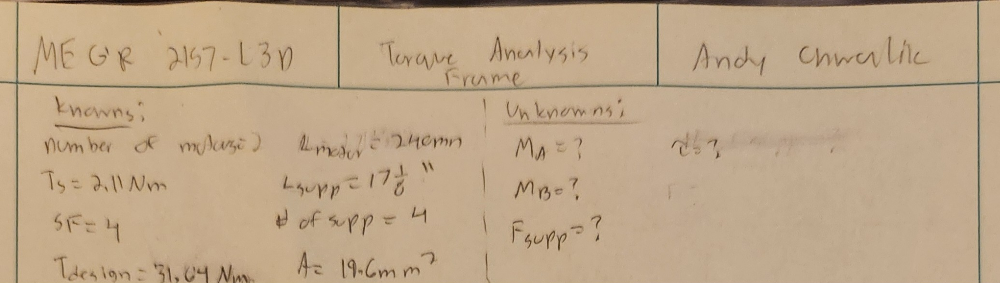

### Free-Body-Diagram

The free-body diagram was a little challenging for me to figure out, but I drew out a bar that was the same length as the top of the bar on our tensile tester. I then put the two motors where the lead screws are to generate torque. The torque from the motors should be in the same direction as each other since they will either be lowering or raising the crosshead together. To counteract this torque, there are moments created on the sides of the frame. These moments will be going in the opposite direction of the torque to keep everything static. From my understanding, this is all that is happening on the top of the frame

    

### Calculations

To calculate my values I just did sum of the moments. My findings from doing this calculations is that the moments on the outside of the frame are proportional to the torque generated from the motors. This makes sense, since the force to counteract the torque will have to be the same if we don't want anything to move. Once I had the moments, I looked for the load induced by the torque. Using the torque equation, I found what would be the force by itself. I then divided this by the number of supports we were thinking of having. Since the design we made in part 1 has four different connectors, I decided to use that many connectors. I then used this force value to help find the shear across an M5 screw, since that is the screw used in the connectors we already have. I got really low values for the shear and force, so I probably did something wrong. I am not sure what I did wrong, so I am going to be using those values as is.

    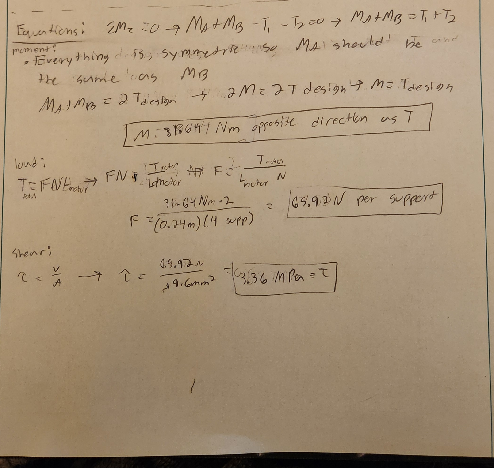

### Connector Choice

Once all of those calculations were done, I had the values I needed to start looking for a connector. When I was looking on McMaster, I couldn't really find anything that had a load capacity on there. When I asked AI for its thinking, it kept suggesting brackets that wouldn't work or also didn't have a visible load capacity on the website. Since the values I found don't seem super big, and the connector I already found is made of steel, I feel comfortable keeping the connectors I already had in place. They should hold the forces pretty well.

    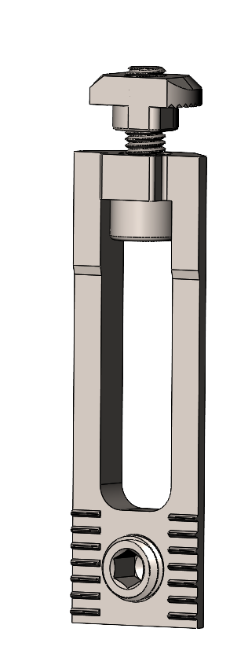

I am not sure if the other connectors I chose are suitable for the job I assigned them, but based on the calculations for the top frame, I would have to say that I feel pretty comfortable in there capabilities. The connectors I chose are pretty common to use and are very similar to the connectors that were in the example for the assignment.

### FEA Analysis

The next step is to simulate the top and support t-bars in the model. We want to make sure that they can withstand the force and torque induced by the motor and the lead screw. This time I made sure that I simulated both parts individually rather than in a giant assembly like last time.

#### Top Frame

##### Setup

Before I created the simulation, I needed to do some preparation. I needed to create a confined area where the torque is actually applied. I am pretty sure the torque is focused in the area where the motors are. So I created a box around where the lead screws will be in order for me to apply the torque and lead screw force.

Another thing I decided to add were holes in the top t-bar frame in order for the lead screw to reach the motors. I was thinking if there are motors all the way on top of the frame, how will the lead screws actually reach them and be powered. The only thing that I could think about are holes in the frame so they can connect to each other.

I also needed to create an axis for my torque to act upon. To do this, I created an axis that was perpendicular to the center axis of the hole I created for the lead screw. I used the point and Face/Plane option when I clicked on the create axis button under create reference geometry. Here is what all of the setup looks like at the end.

    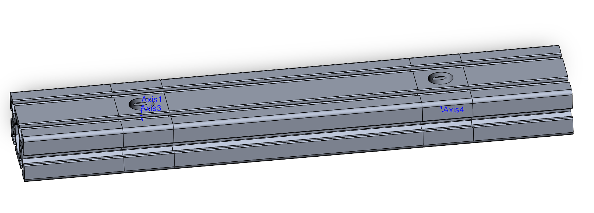

##### Simulation Constraints

<table style="width:100%;">
  <tr>
    <td style="width:60%;">
      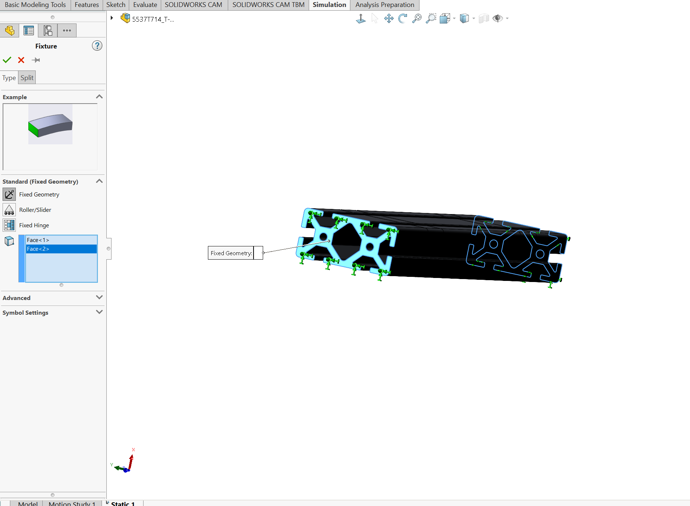
    </td>
    <td style="width:40%; padding:28px; text-align:center; vertical-align:middle;"">
      

        I created a static simulation and then made the edges of the t-bar fixed locations. If the connections I picked are actually strong enough, those shouldn't move much if at all.
      

    </td>
  </tr>
  <tr>
    <td style="width:60%;">
      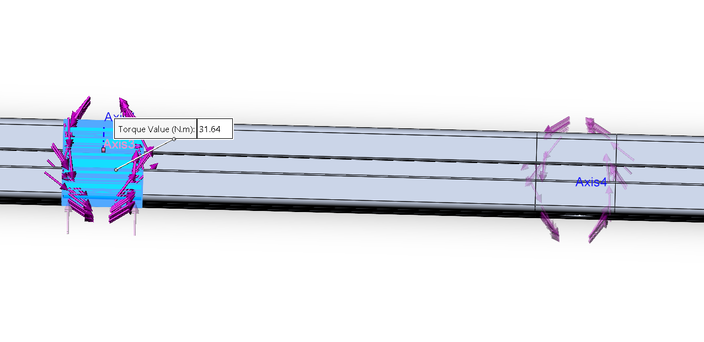
    </td>
    <td style="width:40%; padding:28px; text-align:center; vertical-align:middle;"">
      

        Next, I created the torque. I clicked all of the faces that were in that area I created during the setup process. I then clicked the axis I made during the setup process as my reference geometry. I then set the torque value to 31.64 Nm and clicked confirm. I didn't matter about the direction for the torque because it changes direction depending on which side of the t-bar you're looking at.
      

    </td>
  </tr>
  <tr>
    <td style="width:60%;">
      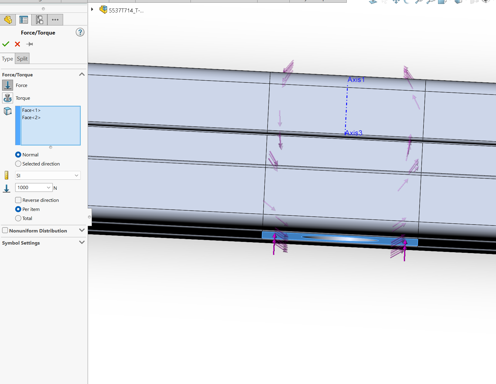
    </td>
    <td style="width:40%; padding:28px; text-align:center; vertical-align:middle;"">
      

        I then added the force in the space at the bottom of where the motors are going to be. I set the force to 1000N. 
      

    </td>
  </tr>
  <tr>
    <td style="width:60%;">
      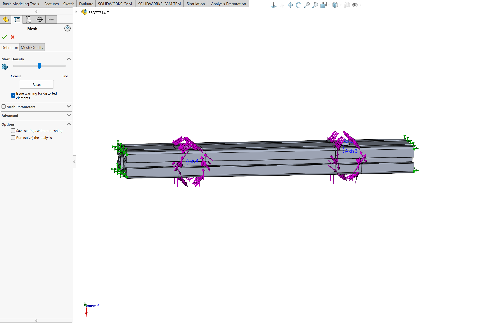
    </td>
    <td style="width:40%; padding:28px; text-align:center; vertical-align:middle;"">
      

        The last thing I did before running the simulation was create a mesh. I used the default mesh density because the t-bars have a lot of connection points at all density levels. That should finish up the simulation constraints.
      

    </td>
  </tr>
</table>

##### Simulation Results

<table style="width:100%;">
  <tr>
    <td style="width:60%;">
      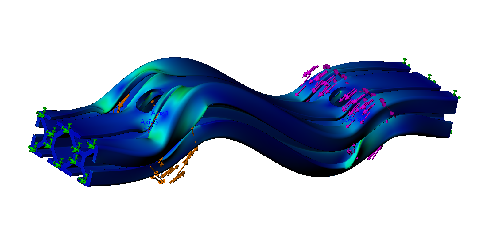
    </td>
    <td style="width:40%; padding:28px; text-align:center; vertical-align:middle;"">
      

        When I first ran the simulation, I got this really funky looking bar. SolidWorks likes to exaggerate the movement of your objects, so I made sure to change all of the scales to true size after seeing this.
      

    </td>
  </tr>
  <tr>
    <td style="width:60%;">
      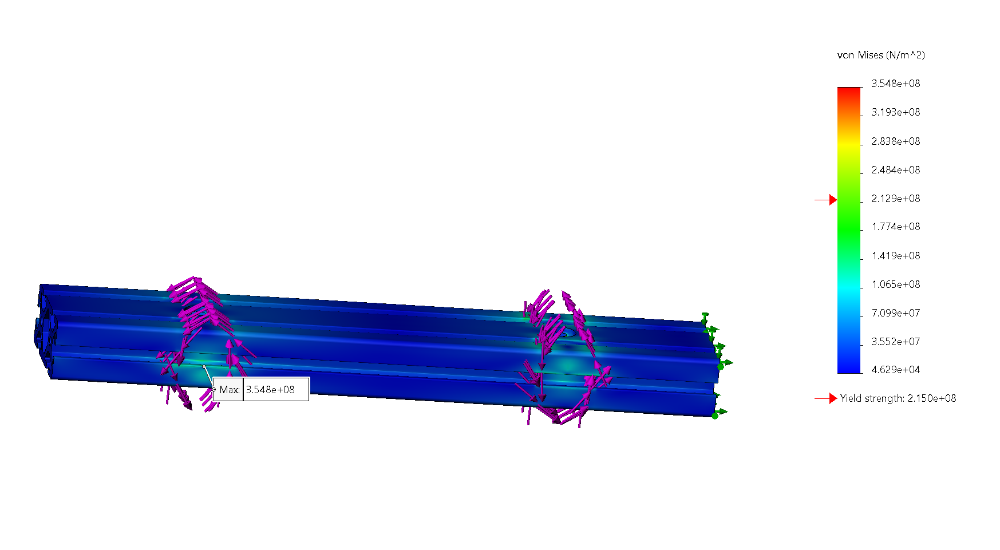
    </td>
    <td style="width:40%; padding:28px; text-align:center; vertical-align:middle;"">
      

        When I looked at my von Misses stress map, I got pretty confused at the largest value. The entire part is blue except for one little edge. It is not shown by the screenshot, but that large force is concentrated in the edge of the bottom of the hole I made for the lead screw. This could be a miscalculation, or it could be due to the fact there will be some sort of body filling that hole. I am sure that won't affect the frame as much as SolidWorks is saying when in practice.
      

    </td>
  </tr>
  <tr>
    <td style="width:60%;">
      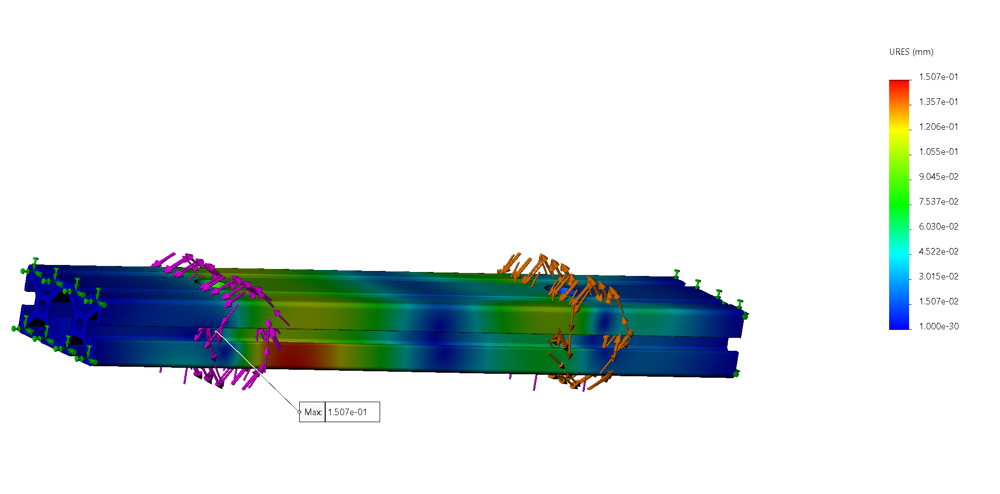
    </td>
    <td style="width:40%; padding:28px; text-align:center; vertical-align:middle;"">
      

        The same thing occurred when I looked at my deflection map. The biggest deflection is in that same hole; however, it does look like part of the main frame bends a lot as well. When I say a lot, I mean 0.15mm. That isn't a lot when looking at it, but our target goal is 0.1mm unless that is only for the crosshead. 
      

    </td>
  </tr>
  <tr>
    <td style="width:60%;">
      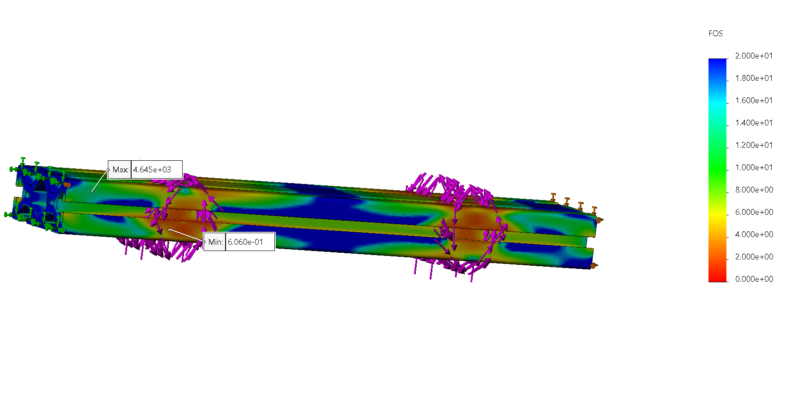
    </td>
    <td style="width:40%; padding:28px; text-align:center; vertical-align:middle;"">
      

        The same thing occurred when I looked at my factor of safety map. This map is the most concerning to me because a lot of the main material seems to also be struggling. A majority of the bar looks to be orangeish yellowish which is somewhere around a safety factor of 4 and 2. Since our target goal is 4, this is not good, and we may need to evaluate new parts.
      

    </td>
  </tr>
</table>

##### Evaluation and Reflection

For how I setup this simulation, the torque and the force from the lead screw will lift up the t-bar, putting the connections on the side in tension. This tension will then put tension and compression on the vertical t-bar all the way down to the feet of the tensile tester. It will reach the elbow connection first, which will then result in the platform holding the load cell to feel the upward force slightly. Everything will then travel down to the feet where it is hopefully bolted down and remains in place.

There was an obvious flaw with the top t-bar: The hole for the lead screw. That put a lot of stress on certain parts of the t-bar and it became a critical point. I think this is just a simulation though as that area will be actually be filled by the lead screw when put in practice. However, I should still take these stress readings into consideration. The hole should at least have curved edges to try and mitigate the stresses on those small areas. 

Another thing with the simulation is that our motor has more torque than what we were prepared for. To adpat to the extra torque, it is probably a good idea to add extra support. Maybe a triangular beam connecting the top t-bar and the vertical t-bars. This will help distribute the load between the two t-bars, which will hopefully lessen the stress at the top of the frame. I think this would create a critical point where that connection is, depending on how thick the connection is. If it isn't think, it could be something to worry about.

#### Vertical Frame

##### Setup

There was much less setup for the vertical t-bar. The only thing I really had to add was a line at the top of the t-bar for the transverse load. The transverse load that is applied to the vertical bar from the motor will only really occur at that top section, so it is important not to overlook.

    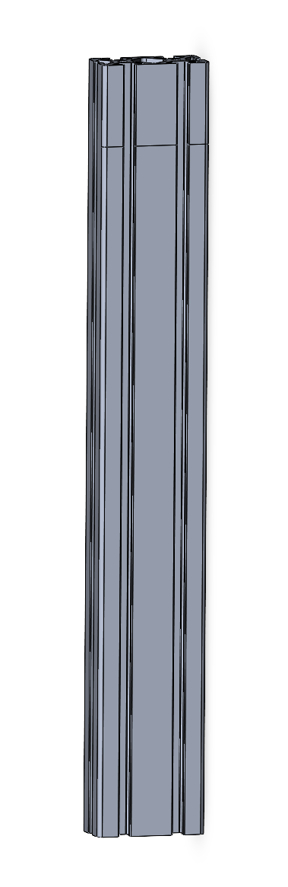

##### Simulation Constraints
  
<table style="width:100%;">
  <tr>
    <td style="width:60%;">
      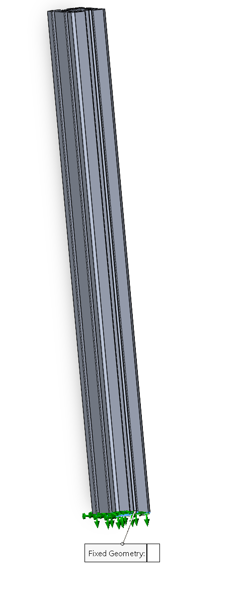
    </td>
    <td style="width:40%; padding:28px; text-align:center; vertical-align:middle;"">
      

        To start constraining the simulation, I made sure to apply my fixture. Since we are looking at the connection point between the top t-bar and the vertical t-bar, I will be applying a fixture to only the bottom of the vertical bar. 
      

    </td>
  </tr>
  <tr>
    <td style="width:60%;">
      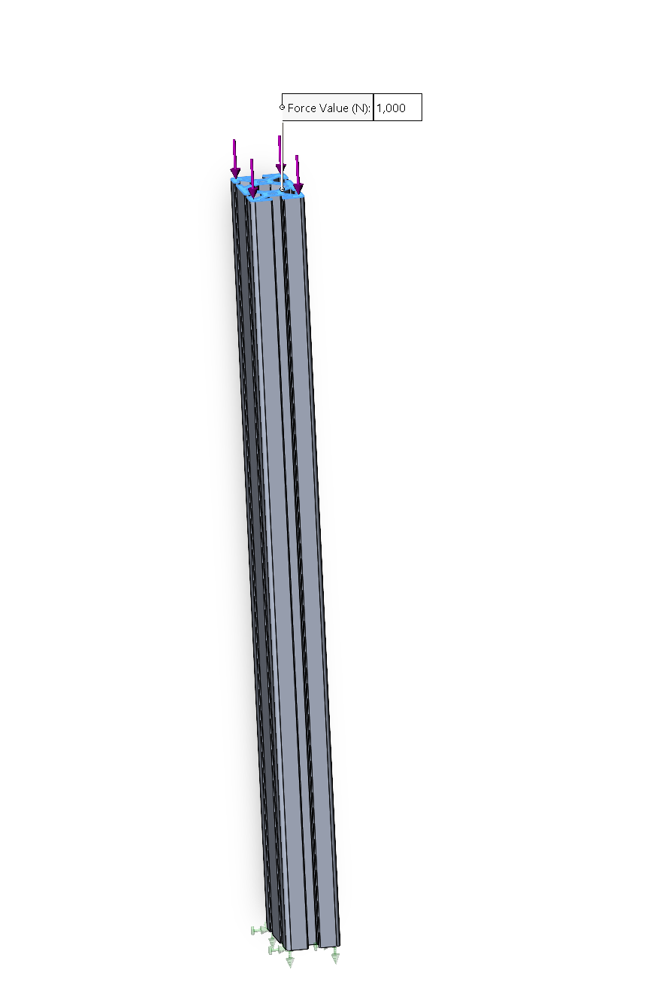
    </td>
    <td style="width:40%; padding:28px; text-align:center; vertical-align:middle;"">
      

        Next, I clicked the opposite end, and applied the axial load. From my understanding this axial load is supposed to be the load supported by the lead screw. That is why it has a value of 1kN.
      

    </td>
  </tr>
  <tr>
    <td style="width:60%;">
      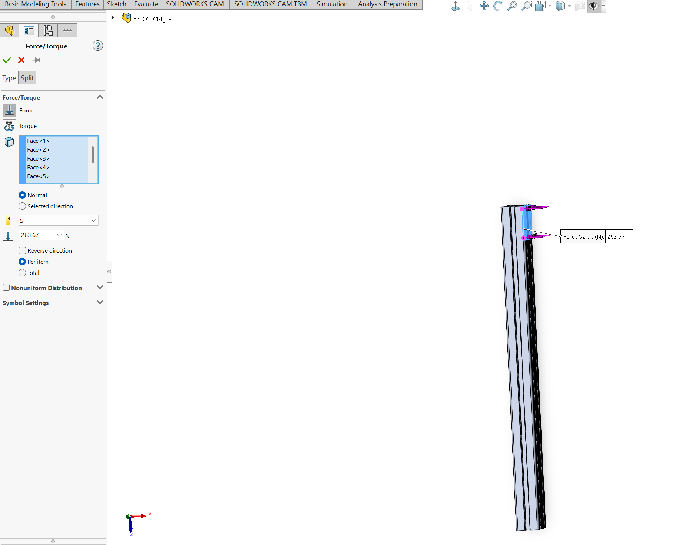
    </td>
    <td style="width:40%; padding:28px; text-align:center; vertical-align:middle;"">
      

        The next thing I had to do was apply that transverse load to that top section I made in the setup phase. The transverse load was found through my earlier calculations. Since I don't have connections to lighten the load, the vertical t-barr will be taking the entire transverse load.
      

    </td>
  </tr>
    <tr>
    <td style="width:60%;">
      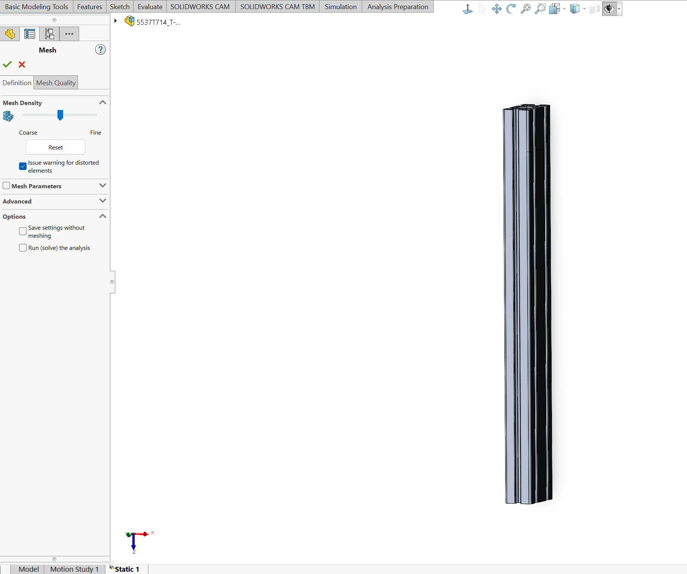
    </td>
    <td style="width:40%; padding:28px; text-align:center; vertical-align:middle;"">
      

        The last thing I did was create a mesh. I just used the default density for the same reasons as the top t-bar.
      

    </td>
  </tr>
</table>

##### Simulation Results

<table style="width:100%;">
  <tr>
    <td style="width:60%;">
      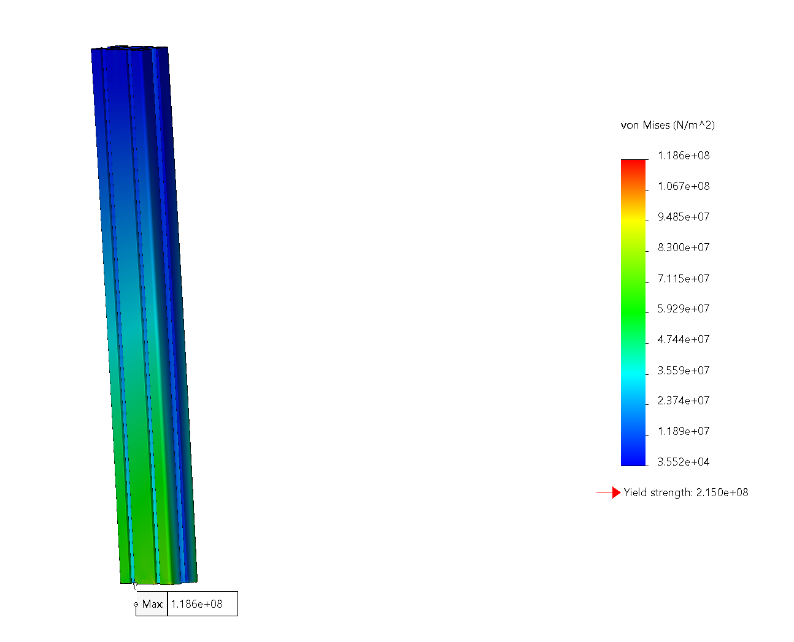
    </td>
    <td style="width:40%; padding:28px; text-align:center; vertical-align:middle;"">
      

        When I ran the simulation, there was a large collection of stress at the bottom of the t-bar. It makes sense since everything is getting compressed down, but I noticed there was this one piece that had a higher stress than normal. It showed up on every test, and it makes me think that is an outlier with the mesh we had. 
      

    </td>
  </tr>
  <tr>
    <td style="width:60%;">
      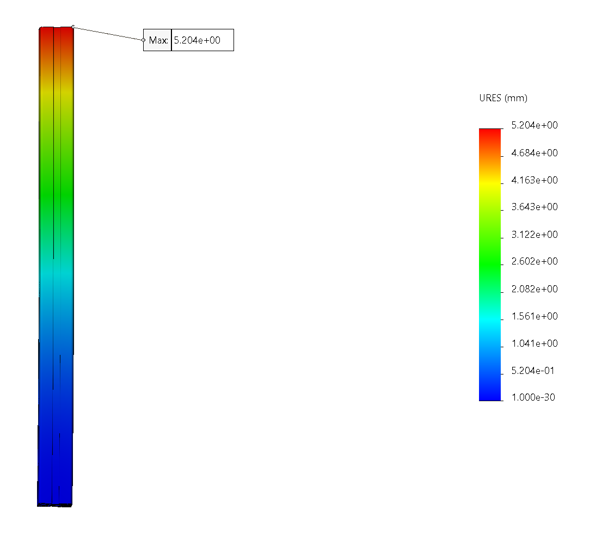
    </td>
    <td style="width:40%; padding:28px; text-align:center; vertical-align:middle;"">
      

        The deflection graph actually showed a lot more movement than I expected. With the transverse load being focused at the top of the t-bar, there is a lot of deflection up there. According to the graph, there is about 5mm worth of movement. That is a significant amount. I think this will be reduced with the connection in place, but that makes me a little more concerned about the stress for the connection. I still think it should be fine because it is made of steel, but it makes me a little nervous. I will say that the deflection gradient on the t-bar matches the same gradient as the legend, which I thought was pretty funny/cool.
      

    </td>
  </tr>
  <tr>
    <td style="width:60%;">
      
    </td>
    <td style="width:40%; padding:28px; text-align:center; vertical-align:middle;"">
      

       The lowest safety factor is in the same spot as that max stress point. I do think this could be a possible miscalculation by SolidWorks, but similar to the top t-bar, there are a lot of lower safety factor measurements. I think the load would be lightened a little bit if the elbow bracket was there, but it seems our frame is reaching its limits with the current values being used.
      

    </td>
  </tr>
</table>

##### Evaluation and Reflection

I already talked about the load path with the top frame, but I am not sure if the feet of the tensile tester have to be bolted down anymore. If there is tension on the vertical t-bars, that will compress the feet further down. I guess with the transverse load, the bolted down feet could stop the tensile tester from tipping or rotating.

Possible improvements for the vertical t-bar is pretty similar to top t-bar. I think that connection between the two will really lighten the load and distribute the forces more evenly. I then the extra triangular attachment I was talking about won't be that expensive will providing extra support. It seems like one of the highest stress areas, so I think it worth the investment to make sure everything is working as intended. 

I think this change will lighten the critical areas, but not change them at all. The transverse load will not cause as much deflection, but I don't think this will change the stresses at all. Based on our results, we don't need to focus on the stress, so I think it will be fine.

## Design Floating Bearing Mount:

#### Andrew's Part:

### RC3 Clearance Fit Class Research:

Looking in the Machinery Handbook, I found that the RC3 Clearance Fit of the floating bearing mount has to be +0.5/0 based on the diameter of the Leadscrew. The diameter that was calculated for the 0.146 in., so the RC3 fit is +.151 in. With this tolerance, there were not any specific floating bearing mounts that fit this specification perfectly but there was one floating bearing mount that would work best for our design, which was the "End Supports for Ball Screws and Precision Lead Screws", Part#: 60755k12, on McMaster-Carr.

### RC3 Clearance Fit:

#### [Floating Bearing Mount CAD File](60755K12_FloatingBearingMount.SLDPRT)

#### Ideal Fit:

#### Chosen Fit:

